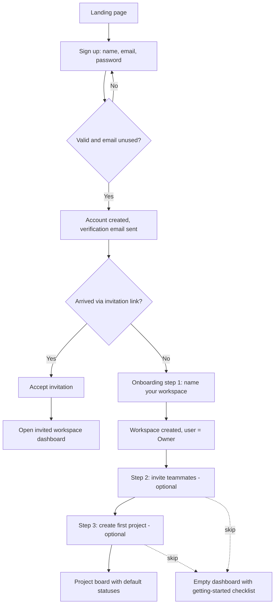
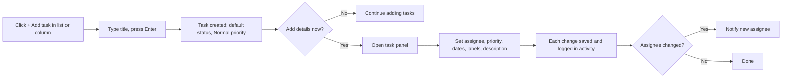
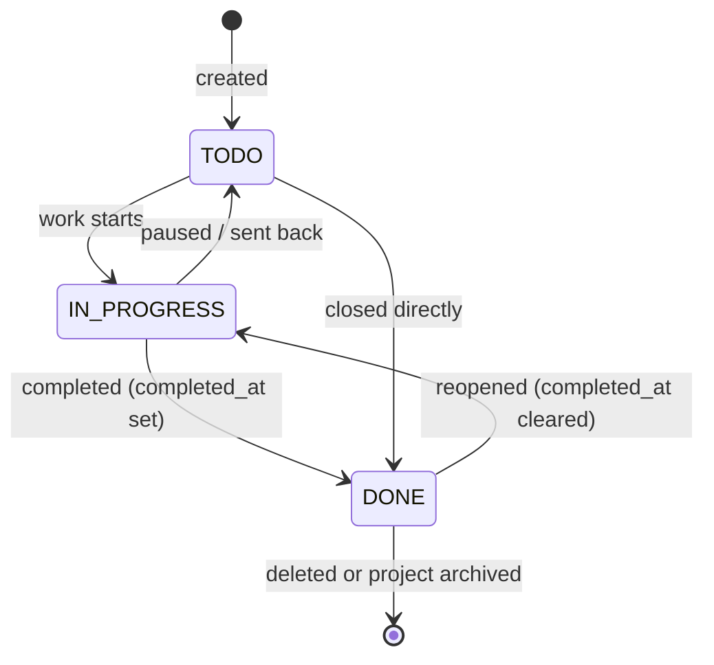
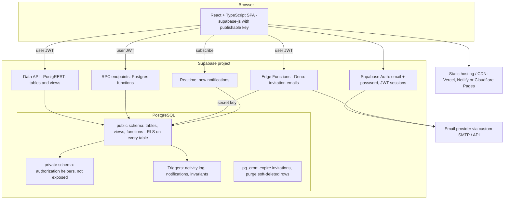
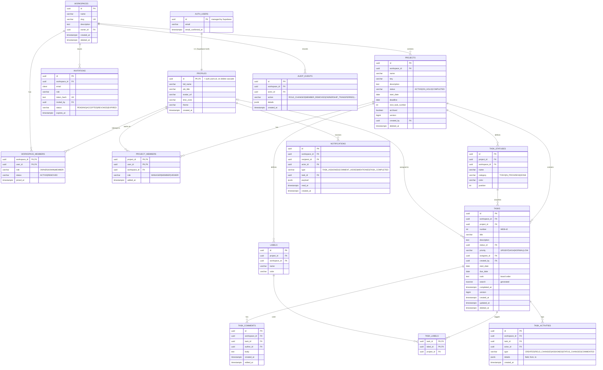
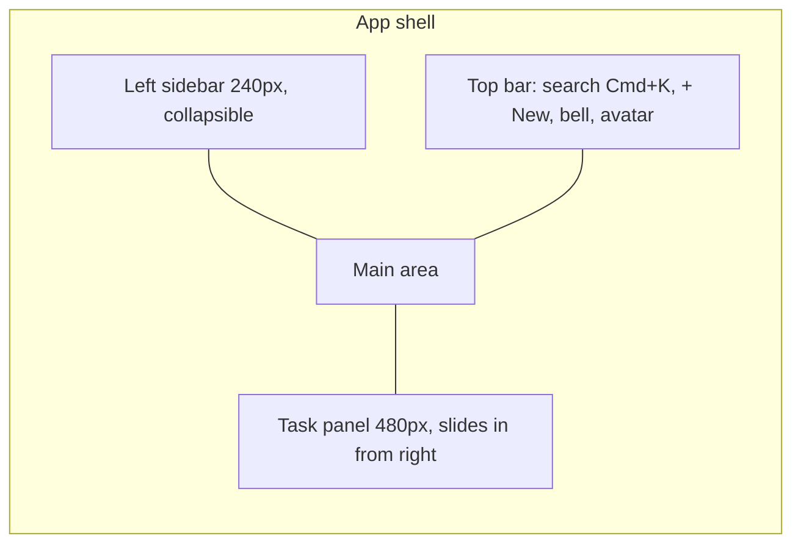
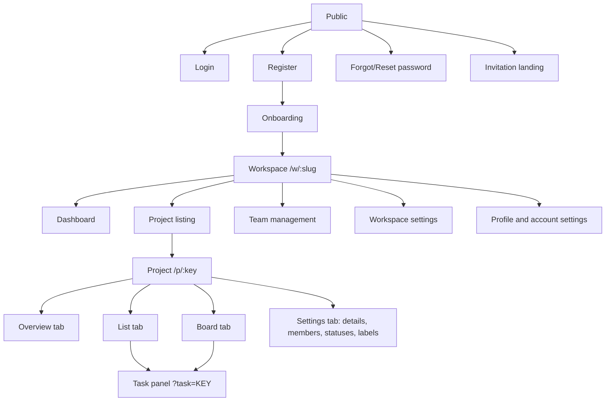
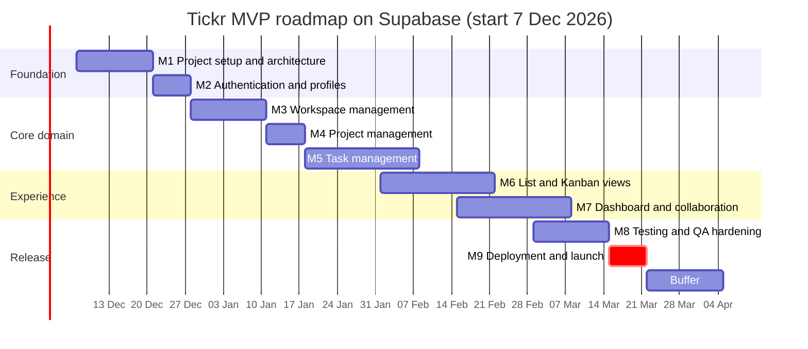

# Project Research and Technical Architecture — ClickUp-Inspired Project Management Platform

Nov 26, 2026 · @Udara San

Product name: **Tickr** (confirm domain and trademark availability before launch).

| Item | Value |
| --- | --- |
| Document type | Research, requirements and technical architecture (pre-implementation) |
| Status | Draft v1.0 for team review |
| Audience | Developers, tech lead, product owner, QA |
| Scope | MVP (v1), v2 and future features of a simplified ClickUp-inspired platform |
| Reading convention | **\[Fact\]** = researched behaviour of an existing product, with a source link. **\[Decision\]** = our proposed design choice. Unmarked text in sections 3–15 is a proposed decision. |

## 1. Executive summary

Tickr is a lightweight team project and task manager: **Workspace → Project → Task**, viewed as a List or a Kanban board, with a personal dashboard, comments, activity history and in-app notifications. Everything else ClickUp offers (Docs, Chat, Goals, automation, AI, 15+ views, custom fields) is deliberately excluded from v1.

Key findings and decisions:

- **Research.** All four products converge on the same core: a container hierarchy, tasks with assignee/status/dates/priority, a List and a Board view, comments and notifications. Complexity comes from depth of hierarchy (ClickUp has five levels), configurable permissions (Jira permission schemes) and paid add-ons (views, automation).
- **Product.** A three-level hierarchy, four fixed priorities, per-project custom statuses mapped to three fixed categories (To Do / In Progress / Done), single assignee per task, Must-Have scope of 50 requirements.
- **Authorization.** Two layers only: a workspace role (Owner, Admin, Member) and a project role (Manager, Member, Viewer). "Project Manager" is a project-level role, not a workspace role.
- **Architecture.** Supabase backend (PostgreSQL, Auth, Data API, Edge Functions) with a React + TypeScript SPA; no separate application server in the MVP. Business rules live in Postgres: Row-Level Security for permissions, RPC functions for multi-step operations, triggers for activity and notifications. Seven modules are kept as separate migration files, functions and frontend feature folders.
- **Data isolation.** Every tenant-owned row carries `workspace_id`; RLS policies on every table enforce membership inside the database, and composite foreign keys stop cross-workspace links.
- **Delivery.** Nine milestones, about 17 weeks for a team of 2–3 developers, List and Kanban by week 11, dashboard and collaboration by week 13, production launch in week 15 with two weeks of buffer.

The main risks are authorization bugs, cross-workspace leaks and scope creep; section 14 gives a mitigation for each.

## 2. Product and competitor research

All four tools share one core model (container → task with assignee, status, dates, priority, comments, shown as list and board). They differ mainly in hierarchy depth, permission configurability and how much sits behind paid plans. Facts below were checked against vendor help centres in November 2026.

### 2.1 ClickUp

- **\[Fact\] Purpose and audience.** An all-in-one work platform for teams of any size and department: tasks, views, Docs, Whiteboards, Chat and Dashboards in one product ([ClickUp blog](https://clickup.com/blog/why-clickup/)).
- **\[Fact\] Hierarchy.** Workspace > Space > Folder > List > Task > Subtask ([ClickUp terms guide](https://clickup.com/blog/the-ultimate-guide-to-clickup-terms-features/)). Folders are optional, and a List can sit directly in a Space ([Intro to the Hierarchy](https://help.clickup.com/hc/en-us/articles/13856392825367-Intro-to-the-Hierarchy)). ClickUp recommends one Space per team, a Folder for projects and one List per project ([Hierarchy best practice](https://help.clickup.com/hc/en-us/articles/20480724378135)).
- **\[Fact\] Tasks.** Statuses, assignees, dates, priorities, dependencies and Custom Fields; subtasks and checklists. Four fixed priorities: Urgent, High, Normal, Low ([Priorities](https://help.clickup.com/hc/en-us/articles/6304483666199-Priorities)). Statuses are customizable per Folder or List ([What are Folders?](https://help.clickup.com/hc/en-us/articles/6311450560407)).
- **\[Fact\] Views.** List and Board exist by default; only List is required at every level ([Customizable features](https://help.clickup.com/hc/en-us/articles/9559764679831-Customizable-ClickUp-features)). Also Calendar, Gantt, Table, Timeline, Workload, Map, Mind map and more; several are usage-capped on lower plans ([Views availability](https://help.clickup.com/hc/en-us/articles/32274881672599-Views-feature-availability-and-limits)).
- **\[Fact\] Roles.** One Owner per Workspace; Admins are members with extra Workspace-management permissions; plus Member and Guest types, with custom roles on higher plans ([Intro to user roles](https://help.clickup.com/hc/en-us/articles/6310033667223-User-Roles)). Spaces can be shared with everyone or made private ([Hierarchy](https://help.clickup.com/hc/en-us/articles/13856392825367-Intro-to-the-Hierarchy)).
- **\[Fact\] Reporting.** Dashboards built from cards that chart tasks, sprints, time and goals ([ClickUp features](https://clickup.com/features)).
- **UX strengths.** Global search/command bar, breadcrumbs, a Views Bar on every location ([Core features](https://help.clickup.com/hc/en-us/articles/6311563319063-Core-ClickUp-features)), one consistent task panel.
- **UX weakness (our assessment).** Five hierarchy levels, dozens of ClickApps and per-level permission overrides create a steep setup curve for small teams.

### 2.2 Trello

- **\[Fact\] Purpose.** Visual Kanban for small teams and personal work; a Workspace is a container for boards ([Trello Workspaces](https://support.atlassian.com/trello/docs/trello-teams)).
- **\[Fact\] Hierarchy.** Workspace > Board > List > Card. Lists are the columns, so status is the list a card sits in.
- **\[Fact\] Views.** Board for everyone; Timeline, Table, Calendar, Dashboard and Map need Premium or Enterprise ([Trello views](https://trello.com/views)).
- **\[Fact\] Roles.** Workspace admins invite and remove members and guests ([Workspace admin capabilities](https://support.atlassian.com/trello/docs/workspace-admin-capabilities)). Being a Workspace member does not grant edit rights on a board; you must be a board member ([Unable to edit a board](https://support.atlassian.com/trello/docs/unable-to-edit-a-workspace-board)). Board admins alone remove users and change commenting permissions ([Board permissions](https://support.atlassian.com/trello/docs/changing-permissions-on-a-board)). Board memberships are admin, normal or observer ([Trello developer forum](https://community.developer.atlassian.com/t/determining-what-actions-user-is-permitted-using-trello-rest-api/33071)).
- **\[Fact\] Automation.** Butler: rules, card/board buttons, calendar and due-date commands ([Trello automation guide](https://trello.com/guide/enterprise/advanced-features)).
- **UX strengths.** Zero-setup boards, drag-and-drop, instantly understandable. **Weakness:** little structure beyond the board; reporting is a paid add-on.

### 2.3 Asana

- **\[Fact\] Purpose.** Cross-functional work management. People are organized into Teams within an organization; work into Portfolios, Projects, Tasks and Subtasks ([How Asana works](https://help.asana.com/s/article/how-asana-works)).
- **\[Fact\] Personal views.** My tasks lists every task assigned to you across projects; Inbox is the notification centre ([Navigating Asana](https://help.asana.com/s/article/navigating-asana)).
- **\[Fact\] Views.** List, Board, Calendar and Timeline; List and Board allow different grouping ([Project views](https://help.asana.com/s/article/project-customization-and-views), [Filter and save views](https://help.asana.com/s/article/filter-and-save-views)). Timeline needs Starter or higher ([Asana project views](https://asana.com/features/project-management/project-views)).
- **\[Fact\] Roles.** User roles: super admin, admin, member, guest; project access levels: admin, editor, commenter, viewer ([Asana permissions](https://asana.com/features/admin-security/permissions)). Editors can add and change content but not the project's name, home team or owner; Editor is the default for new project members ([Editor access](https://help.asana.com/s/article/editor-access-level)).
- **UX strengths.** "My tasks" + Inbox make the daily workflow obvious; clean task pane. **Weakness:** permission interplay (team vs individual vs task collaborator) confuses users.

### 2.4 Jira

- **\[Fact\] Purpose.** Planning and tracking for software and business teams; work items (formerly issues) represent tasks, stories and bugs, grouped under epics ([Work items overview](https://www.atlassian.com/software/jira/guides/issues/overview)).
- **\[Fact\] Features.** Backlog and sprints, boards, timeline, calendar, reports and dashboards ([Jira features](https://www.atlassian.com/cs/software/jira/features)). A dashboard is a collection of gadgets ([Jira dashboards](https://www.atlassian.com/software/jira/guides/reports-dashboards/resources)).
- **\[Fact\] Permissions.** Several layers: global, project/space permission schemes and work-item security ([Types of permissions](https://support.atlassian.com/jira-cloud-administration/docs/types-of-permissions-in-jira/)). Team-managed spaces use simple roles (Administrator, Member, Viewer) and three access levels ([Team-managed access](https://support.atlassian.com/jira-software-cloud/docs/manage-how-people-access-your-team-managed-project)).
- **UX strengths.** Powerful workflows and query language for engineering teams. **Weakness:** configuration overhead; Atlassian itself added "team-managed" projects as a simpler mode.

### 2.5 Comparison

| Dimension | ClickUp | Trello | Asana | Jira | **Tickr (proposed)** |
| --- | --- | --- | --- | --- | --- |
| Primary audience | All teams, power users | Small teams, personal | Cross-functional teams | Software, IT teams | Small teams, agencies, classes |
| Hierarchy | Workspace > Space > Folder > List > Task > Subtask | Workspace > Board > List > Card | Org > Team > Project > Task > Subtask | Site > Project/Space > Epic > Work item > Sub-task | Workspace > Project > Task |
| Status model | Custom per Folder/List | Board columns | Sections / custom fields | Configurable workflows | Custom per project, mapped to 3 fixed categories |
| Priority | 4 fixed flags | Via labels / custom fields | Custom field | Priority field | 4 fixed levels |
| Free-tier views | List, Board, Calendar, Table (+ capped Gantt) | Board | List, Board, Calendar | Board, List, Timeline | List, Board |
| Roles | Owner, Admin, Member, Guest (+ custom) | Workspace admin/member, board admin/normal/observer | Super admin, admin, member, guest; project admin/editor/commenter/viewer | Global + scheme-based or team-managed roles | Workspace Owner/Admin/Member; project Manager/Member/Viewer |
| Reporting | Card-based dashboards | Dashboard view (paid) | Dashboards, portfolios | Gadgets, sprint reports | Fixed personal + project dashboard |
| Automation | Yes | Butler | Rules | Rules | None in MVP |

### 2.6 What the research implies

- **Common to all four:** a top-level shared container, projects/boards, tasks with assignee, status, dates and priority, comments with mentions, list and board views, notifications, role-based membership.
- **Highest everyday value:** "My tasks" across projects, a board with drag-and-drop status change, quick filters (assignee, priority, due), due-soon/overdue signals, task comments and an activity trail.
- **Too complex for us:** Spaces + Folders + Lists, configurable permission schemes, custom fields, dependencies, Gantt/Timeline, sprints, automation, time tracking, Docs/Chat/Whiteboards, AI, guests.
- **Opportunity:** most small teams use a fraction of ClickUp. A product that ships the shared core with **opinionated defaults** (one hierarchy, fixed priorities, three role pairs, no setup wizard beyond "name your workspace") can be productive in under five minutes.

## 3. Product definition

Tickr is a lightweight team collaboration and project management platform that a 3–30 person team can set up in five minutes and use every day without training.

**Vision.** Every small team knows who is doing what, by when, and what is late, without the configuration burden of enterprise tools.

**Problem statement.** Small teams outgrow spreadsheets and chat threads but find ClickUp and Jira heavy: deep hierarchies, dozens of settings, permission schemes and paywalled views. Trello is simple but weak on cross-project visibility ("what is assigned to me everywhere?") and reporting.

**Proposed solution.** A web app with one fixed hierarchy (Workspace → Project → Task), sensible defaults (statuses, priorities, roles), List and Kanban views of the same data, a personal dashboard across all projects, comments, an activity log and in-app notifications.

**Target audience.**

| Segment | Example | Core need |
| --- | --- | --- |
| Small software or digital agencies | 3–15 person studio | Track client projects and deadlines |
| Startup and product teams | 5–30 people | Shared board, clear ownership |
| Academic and training cohorts | Student project groups, instructors | Simple, free-feeling, quick onboarding |
| Internal business teams | Marketing, operations | Visibility of workload and overdue items |

**Primary use cases.**

1. A team lead creates a workspace, invites colleagues and creates a project.
2. A manager breaks the project into tasks, assigns them with due dates and priorities.
3. Members move their tasks across the Kanban board as work progresses.
4. Members discuss a task in comments and see its history.
5. Each user opens the dashboard to see what is assigned, due soon and overdue.
6. A manager checks project progress (percentage done, overdue count).

**Product objectives (first 6 months after launch).**

- New workspace to first task created in under 5 minutes (median).
- At least 60% of weekly active users open the dashboard or board at least 3 days a week.
- Zero cross-workspace data exposure incidents.
- Core pages respond in under 1 second at p95 for workspaces up to 10,000 tasks.

**Functional boundaries.**

| In scope (MVP) | Out of scope (MVP) |
| --- | --- |
| Accounts, workspaces, invitations, roles | SSO/SAML, guests, custom roles |
| Projects with members, status, deadline, archive | Spaces, folders, portfolios, templates |
| Tasks: assignee, status, priority, dates, labels | Subtasks, checklists, dependencies, custom fields, recurring tasks |
| List and Kanban views, filter, sort, group, search | Calendar, Gantt, timeline, workload views |
| Comments, activity history, in-app notifications | Real-time co-editing, chat, email digests, file attachments |
| Personal dashboard, project progress | Custom dashboards, exports, time tracking |
| — | Automation, AI, integrations, mobile apps |

**Key differentiators.**

- **Opinionated simplicity:** one hierarchy, four priorities, three status categories; nothing to configure before work starts.
- **Free-tier-equivalent completeness:** List, Board and dashboard are core, not paid add-ons (unlike Trello views).
- **Cross-project personal focus:** "My work" dashboard from day one, as Asana's My tasks does.
- **Understandable permissions:** two role layers that fit on one screen.

## 4. Functional requirements

The MVP has 70 functional requirements: 50 Must Have, 17 Should Have, 3 Could Have. Must Have = the product is not usable without it; Should Have = expected in v1 if time allows, else first v1.x release; Could Have = nice to have, safe to defer. IDs are stable: reference them in tickets, tests and commits.

### 4.A Authentication and user management

| ID | Requirement | User story | Acceptance criteria | Priority |
| --- | --- | --- | --- | --- |
| FR-AUTH-01 | Register with full name, email and password | As a visitor, I want to create an account so that I can use Tickr | Email unique (case-insensitive); password 8–128 chars with at least one letter and one digit; handled by Supabase Auth (signUp), which stores a bcrypt hash; a profiles row is created by trigger; user lands on onboarding after success | Must |
| FR-AUTH-02 | Log in with email and password | As a user, I want to sign in so that I can reach my workspaces | signInWithPassword returns a session (access JWT + refresh token); invalid credentials show one generic message without saying which field was wrong | Must |
| FR-AUTH-03 | Log out | As a user, I want to sign out so that nobody else uses my session | signOut revokes the refresh token server-side and clears the stored session; protected pages redirect to login | Must |
| FR-AUTH-04 | Stay signed in via token refresh | As a user, I want my session to survive page reloads | supabase-js refreshes automatically; JWT expiry set to 30 min; refresh token rotation with reuse detection enabled in Auth settings | Must |
| FR-AUTH-05 | Change password while signed in | As a user, I want to change my password | Requires current password; new password meets policy; all other sessions revoked | Must |
| FR-AUTH-06 | Reset a forgotten password by email | As a user who forgot my password, I want a reset link | Response identical whether or not the email exists; token single-use, expires in 30 min, stored hashed | Should |
| FR-AUTH-07 | Verify email address | As the system, I want verified emails so that invitations reach real people | Verification link sent on sign-up; unverified users can sign in but see a banner; invitations can be accepted only by the invited, verified email | Should |
| FR-AUTH-08 | View and edit profile | As a user, I want to set my name, job title and avatar so that teammates recognise me | Name 1–100 chars; avatar initials generated by default; email change out of MVP scope | Must |
| FR-AUTH-09 | Basic account settings | As a user, I want to set my time zone and theme | Time zone (IANA id) drives due-soon and overdue calculations; theme light/dark/system | Should |
| FR-AUTH-10 | Delete my account | As a user, I want to delete my account | Blocked while I own any workspace; personal data anonymised; my comments show "Deleted user" | Could |
| FR-AUTH-11 | Throttle failed logins | As the system, I want to slow down password guessing | Supabase Auth rate limits configured for sign-in, sign-up and email endpoints; CAPTCHA (Turnstile or hCaptcha) on sign-up and password reset; 429 shown as "too many attempts, try again later" | Must |

### 4.B Workspace management

| ID | Requirement | User story | Acceptance criteria | Priority |
| --- | --- | --- | --- | --- |
| FR-WS-01 | Create a workspace | As a user, I want to create a workspace for my team | Name 2–60 chars; creator becomes Owner; unique URL slug generated | Must |
| FR-WS-02 | Edit workspace name and description | As an Owner or Admin, I want to keep workspace details current | Only Owner/Admin; change recorded in audit log | Must |
| FR-WS-03 | List and switch workspaces | As a user in several workspaces, I want to switch between them | Switcher lists only workspaces where I am an active member; last used workspace remembered | Must |
| FR-WS-04 | Invite members by email with a role | As an Owner or Admin, I want to invite colleagues | Up to 20 emails per request; role Admin or Member (only Owner may invite Admins); invitation expires after 7 days; duplicate pending invites rejected | Must |
| FR-WS-05 | Accept or decline an invitation | As an invitee, I want to join a workspace from the link | Signed-out invitee is sent to sign-up/login and back; email must match; accepted invite creates membership; used or expired link shows a clear message | Must |
| FR-WS-06 | Resend or revoke a pending invitation | As an Owner or Admin, I want to manage invitations | Revoked link stops working immediately; resend issues a new token | Should |
| FR-WS-07 | View workspace members | As any member, I want to see who is in the workspace | Shows name, avatar, role, join date; pending invites visible to Owner/Admin only | Must |
| FR-WS-08 | Change a member's workspace role | As an Owner or Admin, I want to adjust roles | Rules in section 5.4 (Admins cannot change Owner or other Admins) | Must |
| FR-WS-09 | Remove a member | As an Owner or Admin, I want to remove someone who left | Membership deactivated; their open tasks become unassigned and the project managers are notified; history keeps their name | Must |
| FR-WS-10 | Leave a workspace | As a Member or Admin, I want to leave | Owner cannot leave without transferring ownership; same task handling as removal | Should |
| FR-WS-11 | Transfer ownership | As the Owner, I want to hand the workspace to another Admin | Target must be an active Admin; requires password re-entry; previous Owner becomes Admin | Should |
| FR-WS-12 | Delete a workspace | As the Owner, I want to delete a workspace I no longer need | Requires typing the workspace name; soft-deleted, purged after 30 days | Could |

### 4.C Project management

| ID | Requirement | User story | Acceptance criteria | Priority |
| --- | --- | --- | --- | --- |
| FR-PRJ-01 | Create a project | As an Owner, Admin or Member, I want to create a project | Name 2–100 chars, unique among non-deleted projects of the workspace; 2–6 letter key (e.g. WEB) unique in workspace; creator becomes Project Manager; default statuses created | Must |
| FR-PRJ-02 | Edit name and description | As a Project Manager, I want to describe the project | Description markdown, max 10,000 chars; key immutable after creation | Must |
| FR-PRJ-03 | Set project status | As a Project Manager, I want to show whether the project is Active, On hold or Completed | Status shown on cards and list; filterable | Must |
| FR-PRJ-04 | Set start date and deadline | As a Project Manager, I want a project deadline | Deadline ≥ start date; project overdue badge when deadline passed and status ≠ Completed | Must |
| FR-PRJ-05 | Archive and restore a project | As a Project Manager or Admin, I want to archive finished work | Archived projects are read-only, hidden from default lists and dashboards, restorable | Must |
| FR-PRJ-06 | Delete a project | As an Owner or Admin, I want to remove a project created by mistake | Confirmation by typing the name; soft delete, purge after 30 days | Should |
| FR-PRJ-07 | Add and remove project members | As a Project Manager, I want to choose who works on the project | Only active workspace members can be added; removal unassigns their open tasks in that project | Must |
| FR-PRJ-08 | Set project member role | As a Project Manager, I want to make someone a Manager, Member or Viewer | At least one Project Manager must remain | Must |
| FR-PRJ-09 | List and filter projects | As a user, I want to see my projects | Default shows active projects I belong to; Owner/Admin can toggle "all projects"; filter by status, archived | Must |
| FR-PRJ-10 | Customise project statuses | As a Project Manager, I want statuses that match my workflow | Add, rename, recolour, reorder; each mapped to category TODO, IN\_PROGRESS or DONE; 2–10 statuses; cannot delete a status that holds tasks without choosing a target status | Should |
| FR-PRJ-11 | Manage project labels | As a Project Manager, I want a shared set of labels | Name 1–30 chars unique in project, colour from palette; max 50 labels | Should |

### 4.D Task management

| ID | Requirement | User story | Acceptance criteria | Priority |
| --- | --- | --- | --- | --- |
| FR-TSK-01 | Create a task | As a Project Manager or Member, I want to add a task quickly | Only title required (1–200 chars); inline "+ Add task" in list and in each board column; defaults: first TODO status, priority Normal, no assignee | Must |
| FR-TSK-02 | View task details | As a project member, I want to open a task and see everything about it | Side panel shows all fields, comments and activity; deep link `/w/{slug}/p/{key}/t/{number}` opens it | Must |
| FR-TSK-03 | Edit task fields | As a Project Manager, Member or the assignee, I want to update a task | Inline edit with optimistic UI; optimistic-lock version prevents silent overwrite (409 on conflict) | Must |
| FR-TSK-04 | Delete a task | As a Project Manager or the task creator, I want to delete a wrong task | Confirmation dialog; soft delete; removed from views, dashboards and search | Must |
| FR-TSK-05 | Assign and unassign | As a Project Manager or Member, I want to give a task an owner | Single assignee who must be a project member with Manager or Member role; assignee notified (FR-COL-03) | Must |
| FR-TSK-06 | Task description | As a member, I want a formatted description | Markdown, max 20,000 chars; rendered safely (sanitised HTML) | Must |
| FR-TSK-07 | Set priority | As a member, I want to mark importance | Fixed values Urgent, High, Normal, Low (as ClickUp's four flags); colour + icon, not colour alone | Must |
| FR-TSK-08 | Change status | As a member or the assignee, I want to move a task through its workflow | Status picker or board drag; moving into a DONE-category status sets `completed_at`, moving out clears it | Must |
| FR-TSK-09 | Start and due dates | As a member, I want to plan dates | Date-only values; due ≥ start; overdue = due date before today (user time zone) and not DONE | Must |
| FR-TSK-10 | Apply labels | As a member, I want to tag tasks | 0–10 labels per task from the project's label set | Should |
| FR-TSK-11 | Comment on a task | As a project member (including Viewer), I want to discuss a task | 1–5,000 chars markdown; author can edit (marked "edited") or delete own comment; Project Manager can delete any | Must |
| FR-TSK-12 | Mention people in comments | As a member, I want to @mention a teammate | Autocomplete limited to project members; mentioned user notified | Should |
| FR-TSK-13 | Task activity history | As a member, I want to see who changed what and when | Records create, field changes (old → new), assignment, status, comments added/deleted; newest first; immutable | Must |
| FR-TSK-14 | Human-readable task key | As a member, I want to refer to a task as WEB-42 | Per-project sequence, never reused; searchable | Should |

### 4.E Task visualization

| ID | Requirement | User story | Acceptance criteria | Priority |
| --- | --- | --- | --- | --- |
| FR-VIS-01 | List view | As a member, I want a table of tasks | Columns: key, title, status, assignee, priority, due date, labels; inline edit; paginated or virtualised beyond 100 rows | Must |
| FR-VIS-02 | Kanban board view | As a member, I want a board with one column per status | Columns ordered by status position; card shows title, key, assignee avatar, priority, due date, labels | Must |
| FR-VIS-03 | Drag and drop on the board | As a member, I want to move cards between and within columns | Drop changes status and/or position; Viewer cannot drag; failed save reverts the card with a toast | Must |
| FR-VIS-04 | Filter tasks | As a member, I want to narrow the view | Filters: assignee (incl. "me" and "unassigned"), status, priority, label, due (overdue, this week, no date); combined with AND; reflected in URL | Must |
| FR-VIS-05 | Sort tasks | As a member, I want to order the list | By due date, priority, created, updated, title; asc/desc | Must |
| FR-VIS-06 | Group tasks | As a member, I want tasks grouped | List: by status, priority or assignee; Board: columns by status (default) or swimlanes by assignee/priority | Must |
| FR-VIS-07 | Search tasks | As a user, I want to find a task by words or key | Searches title, description and key across projects I can access in the current workspace; results within 1 s | Must |
| FR-VIS-08 | Remember view settings | As a member, I want my last view, filters and grouping kept per project | Stored per user and project | Should |
| FR-VIS-09 | Show or hide completed tasks | As a member, I want to hide done work | Default: DONE tasks completed more than 14 days ago hidden on the board | Should |

### 4.F Dashboard

| ID | Requirement | User story | Acceptance criteria | Priority |
| --- | --- | --- | --- | --- |
| FR-DSH-01 | My assigned tasks | As a user, I want all my open tasks across projects in one place | Not-DONE tasks assigned to me in active projects of the current workspace, sorted by due date then priority | Must |
| FR-DSH-02 | Due soon | As a user, I want to see what is due in the next 7 days | Count + list; window configurable later | Must |
| FR-DSH-03 | Overdue | As a user, I want overdue tasks highlighted | Count + list, red accent with icon and text | Must |
| FR-DSH-04 | Recently completed | As a user, I want to see what I finished | My tasks completed in the last 7 days | Must |
| FR-DSH-05 | Project progress | As a Project Manager, I want each project's progress | Per project: done/total tasks and %, overdue count, deadline; Owner/Admin see all projects | Must |
| FR-DSH-06 | Basic task statistics | As a Project Manager, I want simple counts | Tasks by status category and by priority for a project; open tasks per assignee | Should |

### 4.G Collaboration

| ID | Requirement | User story | Acceptance criteria | Priority |
| --- | --- | --- | --- | --- |
| FR-COL-01 | Team directory | As a member, I want to see teammates and their roles | Workspace members page and project members tab; shows open-task count per person | Must |
| FR-COL-02 | In-app notification centre | As a user, I want a bell with unread count | List newest first, paginated; unread badge updated live through Supabase Realtime, with 60 s polling as fallback | Must |
| FR-COL-03 | Notify on assignment | As an assignee, I want to know when a task is given to me | Notification to new assignee (not when self-assigned) and to previous assignee on reassignment | Must |
| FR-COL-04 | Notify on comment | As an assignee or task creator, I want to know about new comments | Sent to assignee and creator, never to the comment author | Should |
| FR-COL-05 | Notify on mention | As a user, I want to know when I am mentioned | One notification per mention, deduplicated with FR-COL-04 | Should |
| FR-COL-06 | Notify on status change | As a task creator, I want to know when my task is done | Sent to creator when task enters a DONE-category status | Could |
| FR-COL-07 | Mark notifications read | As a user, I want to clear my notifications | Mark one, mark all; clicking a notification opens the task and marks it read | Must |

## 5. User roles, permissions and business rules

Authorization uses exactly two layers: a **workspace role** decides what you can do to the workspace and whether you see every project; a **project role** decides what you can do inside one project. "Project Manager" from the brief is a project-level role, so the same person can manage one project and be a plain member of another.

### 5.1 Roles

| Layer | Role | Who it is for | Summary |
| --- | --- | --- | --- |
| Workspace | Owner | The creator; exactly one per workspace | Everything, including delete workspace and transfer ownership |
| Workspace | Admin | Team leads, operations | Manage members and all projects; cannot touch the Owner or delete the workspace |
| Workspace | Member | Everyone else | Create projects; see only projects they belong to |
| Project | Manager | Project lead | Full control of one project: settings, members, all tasks |
| Project | Member | Contributor | Create and edit tasks, comment |
| Project | Viewer | Stakeholder, client-side colleague, student observer | Read and comment only |

**\[Decision\]** Owner and Admin act as an implicit Project Manager on every project in their workspace, without a ProjectMember row. This mirrors Trello paid-plan Workspace admins having admin rights on every board ([Trello](https://support.atlassian.com/trello/docs/workspace-admin-capabilities)) and avoids orphaned projects.

### 5.2 Workspace-level permissions

| Action | Owner | Admin | Member |
| --- | --- | --- | --- |
| View workspace and member list | Yes | Yes | Yes |
| Edit workspace name/description | Yes | Yes | No |
| Invite Members | Yes | Yes | No |
| Invite or promote to Admin | Yes | No | No |
| Change a Member's role to Admin / demote an Admin | Yes | No | No |
| Remove a Member | Yes | Yes | No |
| Remove an Admin | Yes | No | No |
| Create a project | Yes | Yes | Yes |
| See and manage all projects | Yes | Yes | No (own projects only) |
| Delete a project | Yes | Yes | No |
| Transfer ownership, delete workspace | Yes | No | No |

### 5.3 Project-level permissions

| Action | Manager (incl. Owner/Admin) | Member | Viewer |
| --- | --- | --- | --- |
| View project, tasks, comments, activity | Yes | Yes | Yes |
| Comment; edit/delete own comments | Yes | Yes | Yes |
| Delete anyone's comment | Yes | No | No |
| Create task | Yes | Yes | No |
| Edit any task field, change status, move on board | Yes | Yes | No |
| Assign / reassign tasks | Yes | Yes | No |
| Delete a task | Yes | Own-created only | No |
| Can be an assignee | Yes | Yes | No |
| Edit project details, status, deadline | Yes | No | No |
| Manage statuses and labels | Yes | No | No |
| Add/remove project members, change project roles | Yes | No | No |
| Archive / restore project | Yes | No | No |

**\[Decision\]** Members may edit any task in their project rather than only their own. Small teams expect this (it matches Asana's Editor default ([Asana](https://help.asana.com/s/article/editor-access-level)) and Jira team-managed Member ([Jira](https://support.atlassian.com/jira-software-cloud/docs/next-gen-permissions/))). Accountability comes from the activity log, not from locks.

### 5.4 Business rules

| ID | Rule |
| --- | --- |
| BR-01 | A workspace always has exactly one Owner. The Owner cannot leave, be removed or be demoted; ownership moves only by transfer to an active Admin. |
| BR-02 | Admins cannot modify, remove or demote the Owner or other Admins. |
| BR-03 | A user may belong to many workspaces; data never crosses workspaces. A project, task, comment, label, notification or invitation belongs to exactly one workspace. |
| BR-04 | Only active workspace members can be project members. Removing a workspace member removes all their project memberships. |
| BR-05 | A project must keep at least one explicit Project Manager. Removing or demoting the last one is rejected (422). |
| BR-06 | A task has zero or one assignee, who must hold a Manager or Member role in that project. |
| BR-07 | When a person loses access to a project (removed from project or workspace, or changed to Viewer), their open tasks in it are unassigned and an activity entry is written; done tasks keep the assignee for history. |
| BR-08 | Archived projects are read-only for everyone: no task, comment, member or settings changes until restored. |
| BR-09 | A task's status must belong to the task's project. Every project has at least one status in each category (TODO, IN\_PROGRESS, DONE). |
| BR-10 | `completed_at` is set when a task enters a DONE-category status and cleared when it leaves one. Progress % = DONE tasks / all non-deleted tasks. |
| BR-11 | Due date must be on or after start date; project deadline on or after project start date. Task dates may fall after the project deadline (warning only). |
| BR-12 | Activity history entries are append-only; nobody can edit or delete them (they are removed only when the parent task is purged). |
| BR-13 | Invitations are bound to one email and one workspace, single-use, expire after 7 days, and can only be accepted by a signed-in user with that verified email. |
| BR-14 | Users never receive notifications for their own actions. |
| BR-15 | Deleting is soft for workspaces, projects and tasks (recoverable 30 days by Owner/Admin via support tooling in v1); comments are hard-deleted, with an activity entry. |

### 5.5 Edge cases to test explicitly

- Owner tries to leave, delete own account or be removed while owning a workspace → blocked with guidance to transfer ownership.
- Admin demotes self to Member → allowed; Admin demotes another Admin → 403.
- Two users edit the same task at once → second save gets 409 with the latest version; UI offers reload.
- Card dragged to a column while another user deleted the task → 404, card removed with a toast.
- User opens a deep link to a task in a project they were removed from → 404 (not 403, to avoid confirming existence).
- Invitation accepted by a user already in the workspace → marked used, no duplicate membership.
- Status deleted while tasks use it → must choose a replacement status; activity written for each moved task.
- Viewer is mentioned in a comment → receives the notification and can reply, but cannot be assigned.
- Project archived while a user has its board open → next write returns 409 "project archived"; UI switches to read-only.

## 6. User journeys and workflows

Nine journeys cover the MVP; the first three get a new team from sign-up to a shared workspace in under five minutes.

### 6.1 Registration, onboarding and workspace creation (J1, J2)

A new user signs up, verifies email (non-blocking), names a workspace, optionally invites teammates and lands in a first project with default statuses. Every onboarding step after workspace creation can be skipped.



### 6.2 Inviting team members (J3)

```mermaid
sequenceDiagram
    actor Admin as Owner/Admin
    participant UI as Web app
    participant EF as Edge Function send-invitations
    participant DB as Postgres (RPC + RLS)
    participant Mail as Email provider
    actor Invitee
    Admin->>UI: Enter emails + role
    UI->>EF: invoke with user JWT (ws_id, invites)
    EF->>DB: rpc create_invitations as the user: role check, dedupe, hashed token, 7-day expiry
    DB-->>EF: invitations + one-time raw tokens
    EF->>Mail: Send invite links
    Mail-->>Invitee: Email with link
    Invitee->>UI: Open /invite/{token}
    UI->>DB: rpc get_invitation_preview(token)
    alt Not signed in
        UI->>Invitee: Sign up or log in, then return
    end
    UI->>DB: rpc accept_invitation(token)
    DB->>DB: Verify token, expiry, confirmed email match; create membership
    DB-->>UI: Workspace
    UI-->>Invitee: Redirect to workspace dashboard
```

### 6.3 Creating a project (J4)

1. User clicks **New project** in the sidebar.
2. Enters name, key (auto-suggested from name), optional description, start date and deadline.
3. Picks members from the workspace and their project roles (default Member).
4. System creates the project, adds the creator as Manager, seeds statuses (To Do, In Progress, In Review, Done) and opens the empty board with an "Add your first task" prompt.

### 6.4 Creating and assigning tasks (J5)



### 6.5 Updating status and managing the Kanban board (J6, J7)

Status changes happen by dragging a card or using the status picker; both call the same endpoint. The UI updates optimistically and rolls back on error.

```mermaid
sequenceDiagram
    actor U as Member
    participant B as Board (React)
    participant Q as Query cache
    participant DB as Postgres (move_task RPC)
    U->>B: Drag card WEB-42 to In Review, position 2
    B->>Q: Optimistic update (move card)
    B->>DB: rpc move_task(task_id, status_id, before, after, expected_version)
    DB->>DB: Check P:Member via private.my_project_ids, status in project, version
    alt OK
        DB->>DB: Update status, rank, version; AFTER trigger writes activity, completed_at, notifications
        DB-->>B: Updated task
        B->>Q: Confirm
    else VERSION_MISMATCH / NOT_FOUND / INVALID_STATUS
        DB-->>B: P0001 error with code
        B->>Q: Roll back + refetch column
        B-->>U: Toast explaining what happened
    end
```

Task lifecycle by status category:



### 6.6 Tracking project progress (J8)

1. Project Manager opens the dashboard → **Projects** widget shows % done, overdue count and deadline per project.
2. Clicks a project → Overview tab shows counts by status category, by priority and open tasks per assignee (FR-DSH-06).
3. Clicks an overdue count → List view opens pre-filtered (`due=overdue`), ready to reassign or re-date.

### 6.7 Completing and reviewing tasks (J9)

1. Assignee moves the card to **In Review** and @mentions the reviewer in a comment.
2. Reviewer gets a mention notification, opens the task, reads the activity trail.
3. Reviewer either moves it to **Done** (creator notified, FR-COL-06) or back to **In Progress** with a comment.
4. Done tasks appear in the assignee's "Recently completed" and count toward project progress.

## 7. System architecture

**Decision: Supabase is the backend.** One Supabase project provides PostgreSQL, Auth, the auto-generated Data API (PostgREST) and Edge Functions. The React SPA calls it through `supabase-js`. There is no separate application server in the MVP; the database is the modular monolith.

### 7.1 Options compared

| Criterion | **Supabase (chosen)** | Spring Boot modular monolith | Microservices |
| --- | --- | --- | --- |
| Time to MVP | Fastest: auth, API, hosting, backups built in | Medium: auth, API layer, ops built by the team | Slowest |
| Authentication | Supabase Auth: sign-up, login, confirmation, reset, rate limits | Hand-built on Spring Security | Separate auth service |
| Authorization | Row-Level Security policies inside Postgres | Java policy classes | Repeated per service |
| Business logic | SQL: RLS, PL/pgSQL functions, triggers | Java services | Spread across services |
| Operations | Managed; no servers | One container + DB | Many pipelines and services |
| Cost at MVP scale | Free for dev; Pro from $25/month for production | One small VM + managed DB | High |
| Lock-in | Medium: Postgres and SQL are portable; Auth, PostgREST conventions and RLS-centred design less so | Low | Low |
| Testing | pgTAP for policies and functions; harder to unit-test than Java | Mature (JUnit, Testcontainers) | Complex |

Supabase wins for a small team because authentication, the CRUD API and hosting come for free and the domain is mostly CRUD with clear membership rules, which is what RLS is designed for. The honest costs: permission bugs now live in SQL policies that "fail silently" by returning empty results, logic in PL/pgSQL is less familiar to review than Java, and a later move off Supabase means rewriting the API layer. Sections 7.6, 10.2 and 14 mitigate these.

### 7.2 High-level architecture



Every request carries the user's JWT, so Postgres knows who is asking (`auth.uid()`) and RLS decides what they may see or change. Only Edge Functions hold the secret key, and they re-check permissions themselves before using it.

### 7.3 Where logic lives

| Kind of operation | Mechanism | Examples |
| --- | --- | --- |
| Reads | `select` on tables or `security_invoker` views, filtered by RLS | Task list, board, members, comments, activity |
| Simple single-row writes | Direct `insert` / `update` / `delete` under RLS; `BEFORE` triggers guard invariants and immutable columns | Edit profile, add or edit own comment, manage labels, mark a notification read |
| Multi-row or rule-heavy writes | RPC: PL/pgSQL function, one transaction, raises coded errors | `create_workspace`, `accept_invitation`, `create_project`, `create_task`, `move_task`, `remove_workspace_member`, `change_project_role` |
| Side effects of a change | `AFTER` triggers in the same transaction | Activity entries, notifications, `completed_at` |
| Needs a secret or external API | Edge Function (TypeScript on Deno) | Send and resend invitation emails |
| Scheduled work | `pg_cron` jobs | Expire invitations after 7 days; purge soft-deleted rows after 30 days |

### 7.4 Modules and boundaries

The seven modules from the original design remain; boundaries are now enforced by convention, file layout and review rather than by a framework.

| Module | Tables | Functions (RPC) | Triggers / Edge |
| --- | --- | --- | --- |
| identity | profiles | — | `on_auth_user_created` creates profile |
| workspace | workspaces, workspace\_members, invitations | `create_workspace`, `update_member_role`, `remove_workspace_member`, `leave_workspace`, `transfer_ownership`, `create_invitations`, `revoke_invitation`, `get_invitation_preview`, `accept_invitation` | Edge: `send-invitations` |
| project | projects, project\_members, task\_statuses, labels | `create_project`, `archive_project`, `restore_project`, `delete_project`, `add_project_member`, `change_project_role`, `remove_project_member`, `reorder_statuses`, `delete_status` | Seeds default statuses |
| task | tasks, task\_labels | `create_task`, `update_task`, `move_task`, `delete_task`, `search_tasks` | Validate assignee/status, bump `version`, set `completed_at` |
| collaboration | task\_comments, task\_activities | — | Write activity on task/comment changes; parse mentions |
| notification | notifications | `mark_all_notifications_read` | Create notifications from task/comment triggers |
| dashboard | none | `dashboard_me`, `project_progress`, `project_stats` | — |

Rules: one migration file per module change (`supabase/migrations/<timestamp>_<module>_<change>.sql`); a module's tables are written only by its own functions and triggers; cross-module checks go through helpers in the `private` schema (`private.workspace_role`, `private.project_role`); every RPC lives in `public` only if the browser must call it.

### 7.5 Authentication flow

```mermaid
sequenceDiagram
    participant SPA
    participant Auth as Supabase Auth
    participant API as Data API (PostgREST)
    participant PG as PostgreSQL + RLS
    SPA->>Auth: signInWithPassword(email, password)
    Auth-->>SPA: session: access JWT + refresh token
    SPA->>API: GET /rest/v1/tasks?project_id=eq.X (apikey + Bearer JWT)
    API->>PG: run as role authenticated with JWT claims
    PG->>PG: RLS policy: project_id in my_project_ids(VIEWER)
    PG-->>API: only permitted rows
    API-->>SPA: 200 JSON
    Note over SPA,Auth: supabase-js refreshes the JWT before expiry; reuse of an old refresh token revokes the session
```

Auth configuration for production:

- Email + password provider with **email confirmation on**; password recovery and email change use Supabase's built-in flows and templates.
- **Custom SMTP is mandatory**: Supabase's default sender is for testing only, has significant rate limits and no delivery SLA ([Supabase custom SMTP](https://supabase.com/docs/guides/auth/auth-smtp)); after enabling it, raise the Auth email rate limit to fit invitations and resets.
- Use the new **publishable key** in the browser and the **secret key** only in Edge Functions; Supabase is deprecating the legacy `anon` and `service_role` keys by the end of 2026 ([API keys](https://supabase.com/docs/guides/api/api-keys)). Enable asymmetric **JWT signing keys**, which publish public keys at a JWKS endpoint for local verification ([Signing keys](https://supabase.com/features/jwt-signing-keys)).
- JWT expiry 30 minutes, refresh-token rotation with reuse detection on, CAPTCHA on sign-up and reset.
- **Session storage trade-off:** in a pure SPA, supabase-js keeps the session in `localStorage`, so XSS could steal it. Mitigation: strict CSP, sanitised markdown, no third-party scripts in the app shell. If the team wants HttpOnly cookie sessions instead, use Next.js with `@supabase/ssr` (ADR-04).

### 7.6 Authorization in Postgres (RLS)

Every table in `public` has RLS enabled with policies for `select`, `insert`, `update` and `delete` written for the `authenticated` role. Role lookups go through `security definer` helpers in a non-exposed `private` schema, following Supabase's guidance to index policy columns, wrap function calls in `select` and avoid running RLS on join tables ([RLS performance](https://supabase.com/docs/guides/troubleshooting/rls-performance-and-best-practices-Z5Jjwv)).

```sql
-- Helpers live in a schema the Data API does not expose
create schema if not exists private;
grant usage on schema private to authenticated;

create or replace function private.my_project_ids(min_role text default 'VIEWER')
returns setof uuid
language sql stable security definer set search_path = ''
as $$
  -- explicit project membership at or above min_role
  select pm.project_id
  from public.project_members pm
  join public.workspace_members wm
    on wm.workspace_id = pm.workspace_id and wm.user_id = pm.user_id and wm.status = 'ACTIVE'
  where pm.user_id = (select auth.uid())
    and case min_role
          when 'VIEWER'  then true
          when 'MEMBER'  then pm.role in ('MEMBER', 'MANAGER')
          when 'MANAGER' then pm.role = 'MANAGER'
        end
  union
  -- Owner and Admin are implicit managers of every project in their workspace
  select p.id
  from public.projects p
  join public.workspace_members wm on wm.workspace_id = p.workspace_id
  where wm.user_id = (select auth.uid()) and wm.status = 'ACTIVE'
    and wm.role in ('OWNER', 'ADMIN')
$$;

alter table public.tasks enable row level security;

create policy "tasks_select_project_members" on public.tasks
  for select to authenticated
  using (deleted_at is null and project_id in (select private.my_project_ids('VIEWER')));

-- Writes to tasks go through update_task / move_task RPCs; direct update is not granted
revoke update, delete on public.tasks from authenticated;
```

Rules that make RLS safe here:

- RLS on every table, checked in CI by a pgTAP test that fails if any `public` table has it off, plus `supabase db advisors` for security findings ([Advisors](https://supabase.com/docs/guides/observability/advisors.md)).
- `security definer` functions always set `search_path = ''`, use fully qualified names and re-check `auth.uid()` membership before acting.
- Immutable columns (`workspace_id`, `project_id`, `number`, `created_by`) are protected by column privileges and a `BEFORE UPDATE` trigger.
- Write helpers exclude archived projects so BR-08 (read-only archive) holds for every path.
- Remember that a blocked `select` returns zero rows rather than an error; tests must assert both what a user can see and what they cannot.

### 7.7 Error handling

- RPC functions raise coded errors: `raise exception 'LAST_PROJECT_MANAGER' using errcode = 'P0001', hint = 'Promote another member first';`.
- One frontend function `toAppError(error)` maps Supabase/PostgREST errors to the codes in section 9.1: `P0001` + message → business code; `42501` → `FORBIDDEN`; `23505` → `CONFLICT` (duplicate); `23503` / `23514` / `22P02` → `VALIDATION_ERROR`; `PGRST116` (no row for `.single()`) → `NOT_FOUND`; Auth 429 → `RATE_LIMITED`.
- Optimistic locking: `update_task(task_id, changes, expected_version)` and `move_task(...)` compare `version` and raise `VERSION_MISMATCH`; this is why task writes use RPC rather than direct updates (a direct update blocked by RLS or a stale version silently affects zero rows).
- Edge Functions return the same `{ code, message, details }` JSON shape and log the error with a request id.

### 7.8 Validation strategy

| Where | What | Tool |
| --- | --- | --- |
| Frontend forms | Instant feedback; same limits as the database | react-hook-form + Zod |
| RPC functions | Business rules: status belongs to project, assignee is a project Member/Manager, last manager, Owner protections | PL/pgSQL checks raising `P0001` codes |
| Triggers | Invariants on direct writes: immutable columns, date order, `completed_at` | `BEFORE` triggers |
| Schema | NOT NULL, FK (incl. composite), UNIQUE, CHECK, enum-like checks | PostgreSQL constraints |
| Edge Functions | Request body shape | Zod |

### 7.9 Logging and observability

- Supabase Logs Explorer for API, Postgres, Auth, Realtime and Edge Function logs; Security and Performance Advisors reviewed before each release.
- Admin actions (role change, member removal, ownership transfer, workspace edits) are written by their RPC to an `audit_events` table.
- Sentry (or similar) in the SPA and Edge Functions; errors carry the Supabase request id when present.
- Never log passwords, tokens or invitation tokens; invitation tokens are stored only as hashes.

### 7.10 Data access, types and migrations

- Schema as code with the Supabase CLI: `supabase migration new`, local stack via `supabase start` (Docker), `supabase db reset` to rebuild from migrations + `seed.sql`, and `supabase db push` from CI to staging and production. No schema edits in the production dashboard.
- Generated types: `supabase gen types typescript` into `src/types/database.ts`; every query is typed.
- Queries always filter explicitly (`.eq('project_id', id)`) even though RLS would restrict rows, because policies are not a substitute for filters ([RLS performance](https://supabase.com/docs/guides/database/postgres/row-level-security-performance.md)).
- Use resource embedding for joins (`status:task_statuses(name, category), assignee:profiles(full_name, avatar_url)`), `.range()` for paging and `{ count: 'exact', head: true }` for badge counts.
- Primary keys `uuid default gen_random_uuid()`; human task keys from a per-project counter incremented inside `create_task`.

### 7.11 Frontend architecture

| Concern | Choice |
| --- | --- |
| Build | Vite + React + TypeScript (strict); Next.js + `@supabase/ssr` is the alternative if cookie sessions or SSR are wanted |
| Routing | React Router; `/w/:slug/dashboard`, `/w/:slug/p/:key/board`, `/w/:slug/p/:key/list`, `?task=WEB-42` opens the panel |
| Data layer | `supabase-js` with generated types, wrapped in `src/features/*/api/*.ts`; components never call Supabase directly |
| Server state | TanStack Query: caching, refetch on focus, optimistic updates with rollback |
| Realtime | One channel per user for new `notifications` rows; board uses refetch, not realtime, in the MVP |
| Client/UI state | Component state + small Zustand store (current workspace, sidebar, theme) |
| Forms | react-hook-form + Zod |
| UI | Tailwind CSS + shadcn/ui (Radix primitives) |
| Drag and drop | dnd-kit (keyboard accessible) |

## 8. Database design

PostgreSQL on Supabase, 3NF, 14 tables in the `public` schema. Accounts live in Supabase's `auth.users`; our **User** entity becomes `profiles` (same id). All ten suggested entities are kept; **TaskLabel** is split into `labels` and `task_labels`, and `task_statuses`, `invitations` and `audit_events` are added. Refresh tokens, password hashes and reset tokens are managed by Supabase Auth, so we store none. Every tenant-owned table carries `workspace_id`.

### 8.1 Entity necessity for the MVP

| Entity | MVP? | Why |
| --- | --- | --- |
| User → `auth.users` (Supabase) + `profiles` | Yes | Credentials and sessions in Supabase Auth; name, avatar, time zone in `profiles` |
| Workspace, WorkspaceMember | Yes | Tenancy and workspace roles |
| Invitation | Yes (added) | Invite by email before the person has an account |
| Project, ProjectMember | Yes | Projects and project roles |
| TaskStatus | Yes (added) | Board columns; per-project customisation without schema change |
| Task | Yes | Core |
| Label + TaskLabel | Yes (Should) | Tagging; cheap to build now, painful to retrofit |
| TaskComment | Yes | Collaboration |
| TaskActivity | Yes | History and audit trail per task |
| Notification | Yes | In-app notifications |
| AuditEvent | Yes (added) | Workspace-level admin actions (FR-WS-02, role changes, removals) |
| RefreshToken, PasswordResetToken | No | Handled by Supabase Auth |

### 8.2 ER diagram



### 8.3 Relationship notes

- **User ↔ Workspace** is many-to-many through `workspace_members`, which carries the workspace role. Removed members keep their row with `status = REMOVED` so history still resolves names.
- **Workspace → Project → Task** is strict one-to-many; a task never moves between workspaces. Moving a task between projects is out of MVP scope.
- **User ↔ Project** is many-to-many through `project_members` (project role). Owner/Admin access is derived from `workspace_members`, not stored here.
- **Task → Status** many-to-one; the status must belong to the same project (composite FK). **Task → Assignee** optional many-to-one.
- **Task ↔ Label** many-to-many through `task_labels`; both sides must belong to the same project.
- **Task → Comments, Activities** one-to-many, cascade-deleted only when a task is purged.
- **Notification** references the task for deep links; `payload` stores display text (task key, title, actor name) so the list renders without joins.

### 8.4 Key constraints

| Table | Constraint |
| --- | --- |
| profiles | PK `id` references `auth.users(id) on delete cascade`; row created by an `after insert` trigger on `auth.users`; `CHECK (char_length(full_name) BETWEEN 1 AND 100)`; email uniqueness enforced by Supabase Auth |
| workspaces | `UNIQUE (slug)`; `owner_id` FK users |
| workspace\_members | PK `(workspace_id, user_id)`; `CHECK role IN (...)`; partial unique index `ON (workspace_id) WHERE role = 'OWNER' AND status = 'ACTIVE'` enforces exactly one active Owner |
| invitations | Partial unique `(workspace_id, lower(email)) WHERE status = 'PENDING'` |
| projects | `UNIQUE (id, workspace_id)` (target for composite FKs); partial unique `(workspace_id, lower(name))` and `(workspace_id, key)` where `deleted_at IS NULL`; `CHECK (deadline IS NULL OR start_date IS NULL OR deadline >= start_date)` |
| project\_members | PK `(project_id, user_id)`; FK `(project_id, workspace_id) → projects(id, workspace_id)`; FK `(workspace_id, user_id) → workspace_members` |
| task\_statuses | `UNIQUE (id, project_id)`; `UNIQUE (project_id, lower(name))`; `CHECK category IN ('TODO','IN_PROGRESS','DONE')` |
| labels | `UNIQUE (id, project_id)`; `UNIQUE (project_id, lower(name))` |
| tasks | FK `(project_id, workspace_id) → projects(id, workspace_id)`; FK `(status_id, project_id) → task_statuses(id, project_id)`; `UNIQUE (project_id, number)`; `CHECK (due_date IS NULL OR start_date IS NULL OR due_date >= start_date)`; `CHECK priority IN (...)`; `char_length(title) BETWEEN 1 AND 200` |
| task\_labels | FK `(task_id, project_id) → tasks(id, project_id)` and `(label_id, project_id) → labels(id, project_id)` so a label from another project cannot be attached |
| task\_comments, task\_activities | FK `task_id` with `ON DELETE CASCADE` (fires only on hard purge) |
| notifications | FK `recipient_id`; `task_id` nullable with `ON DELETE SET NULL` |

Assignee membership (BR-06) and "at least one manager" (BR-05) are enforced in the application layer because they span rows; the composite FKs above make cross-project and cross-workspace links impossible even if application code has a bug.

### 8.5 Indexes

| Index | Serves |
| --- | --- |
| `tasks (project_id, status_id, rank) WHERE deleted_at IS NULL` | Board columns and ordering; RLS filter on `project_id` |
| `tasks (workspace_id, assignee_id, due_date) WHERE deleted_at IS NULL AND completed_at IS NULL` | Dashboard: my open, due soon, overdue |
| `tasks (workspace_id, assignee_id, completed_at DESC)` | Recently completed |
| `tasks (project_id, priority)`, `tasks (project_id, due_date)` | List filters and sorts |
| GIN on generated `tasks.search` tsvector + `pg_trgm` on title | Search (FR-VIS-07) |
| `workspace_members (user_id, workspace_id) WHERE status = 'ACTIVE'` | Workspace switcher and RLS helpers |
| `project_members (user_id, project_id)` | RLS helper `my_project_ids` |
| `task_comments (task_id, created_at)`, `task_activities (task_id, created_at DESC)` | Task panel |
| `notifications (recipient_id, workspace_id, created_at DESC)` + partial `WHERE read_at IS NULL` | Bell list, unread count, RLS on `recipient_id` |
| `invitations (token_hash)` unique | Accepting an invitation |

Board ordering uses a string **rank** (fractional indexing, e.g. LexoRank-style) so a drag updates one row instead of renumbering a column.

### 8.6 Workspace isolation (defence in depth)

1. **RLS on every table** (primary control): policies check workspace or project membership through `private.my_workspace_ids()` / `private.my_project_ids(role)`; the browser can never read or write a row outside its memberships, whatever query it sends.
2. **No privileged key in the browser:** only the publishable key ships to clients; the secret key (which bypasses RLS) is used only inside Edge Functions after an explicit membership check.
3. **RPC functions re-check:** every `security definer` function verifies the caller's role for the target workspace/project before writing, and sets `search_path = ''`.
4. **Schema:** `workspace_id` on every tenant row + composite FKs, so rows from two workspaces cannot be linked even by a buggy function.
5. **Tests:** pgTAP suite with two workspaces and users of every role asserts, per table and per RPC, which rows each user can and cannot see or change; a test fails the build if any `public` table has RLS disabled.
6. **Advisors:** `supabase db advisors` (security) runs in CI and before every release.

### 8.7 Normalization approach

The schema is in third normal form: each fact lives in one place (role in membership tables, status definitions in `task_statuses`, labels in `labels`). Two deliberate, controlled denormalisations: `workspace_id` copied onto child tables (for isolation and index-only filters, kept correct by composite FKs) and `notifications.payload` (a display snapshot, never used for decisions). Dashboard numbers are computed by queries, not stored; add a materialised summary only if p95 targets are missed.

## 9. API specification (Supabase)

The API is Supabase's own: the auto-generated Data API for tables and views, 28 RPC functions, 2 Edge Functions and the Supabase Auth endpoints, all called through typed `supabase-js`. No REST controllers are hand-written. Each operation below names its call, who may do it and how that is enforced, and its specific errors.

### 9.1 Conventions

- **Transport:** HTTPS to `https://<project>.supabase.co` — `/auth/v1` (Auth), `/rest/v1/<table>` (Data API), `/rest/v1/rpc/<function>` (RPC), `/functions/v1/<name>` (Edge). supabase-js sends `apikey: <publishable key>` and `Authorization: Bearer <user JWT>`.
- **Who column:** minimum role (W: workspace role, P: project role; Owner/Admin satisfy any P: role). Enforced by **RLS** (policy on the table), **RPC** (check inside the function) or **Edge** (check in the function before using the secret key).
- **Responses:** supabase-js returns `{ data, error, count }`. The app's `toAppError()` (7.7) turns `error` into `{ code, message, details }` with these codes: `VALIDATION_ERROR`, `UNAUTHENTICATED`, `FORBIDDEN`, `NOT_FOUND`, `CONFLICT`, `VERSION_MISMATCH`, `PROJECT_ARCHIVED`, `RATE_LIMITED`, `INTERNAL_ERROR`, plus business codes such as `LAST_PROJECT_MANAGER`. A read blocked by RLS returns an empty result (shown as not found), never someone else's data.
- **Data:** ids UUID, dates `YYYY-MM-DD`, timestamps ISO-8601 UTC; paging with `.range(from, to)`, at most 100 rows; counts with `{ count: 'exact' }`.

### 9.2 Authentication (Supabase Auth)

| Operation | Call | Who | Specific errors |
| --- | --- | --- | --- |
| Register | `auth.signUp({ email, password, options: { data: { full_name } } })` | Public (CAPTCHA) | `user_already_exists`, weak password, 429 |
| Log in | `auth.signInWithPassword({ email, password })` | Public | `invalid_credentials`, `email_not_confirmed`, 429 |
| Refresh session | automatic in supabase-js | Session | refresh token revoked or reused → signed out |
| Log out | `auth.signOut()` | Session | — |
| Forgot password | `auth.resetPasswordForEmail(email, { redirectTo })` | Public (CAPTCHA) | 429 (same response whether or not the email exists) |
| Reset / change password | `auth.updateUser({ password })` after recovery link or while signed in (with reauthentication) | Session | weak password |
| Confirm email | link in email → `auth.verifyOtp` / PKCE exchange | Public | expired link |

### 9.3 Users (profiles)

| Operation | Call | Who | Specific errors |
| --- | --- | --- | --- |
| Get my profile | `from('profiles').select().eq('id', uid).single()` | Self (RLS) | — |
| Update profile and settings | `from('profiles').update({ full_name, job_title, avatar_url, time_zone, theme }).eq('id', uid)` | Self (RLS) | `VALIDATION_ERROR` (CHECK) |
| See teammates' profiles | `from('profiles').select('id, full_name, avatar_url, job_title')` | Shares a workspace (RLS) | — |
| Delete account (Could) | Edge `delete-account` | Self (Edge: blocks if Owner) | `OWNS_WORKSPACE` |

### 9.4 Workspaces

| Operation | Call | Who | Specific errors |
| --- | --- | --- | --- |
| List my workspaces | `from('workspace_members').select('role, workspace:workspaces(id, name, slug)').eq('user_id', uid)` | Self (RLS) | — |
| Create workspace | `rpc('create_workspace', { name })` → workspace + Owner membership + slug | Signed in (RPC) | `VALIDATION_ERROR` |
| Get workspace | `from('workspaces').select().eq('slug', slug).single()` | W:Member (RLS) | `NOT_FOUND` |
| Edit name / description | `from('workspaces').update({ name, description }).eq('id', wsId)` | W:Admin (RLS; trigger writes `audit_events`) | `FORBIDDEN` (0 rows) |
| Transfer ownership | `rpc('transfer_ownership', { ws_id, new_owner_id })` (UI asks for reauthentication first) | W:Owner (RPC) | `TARGET_NOT_ADMIN` |
| Delete workspace (Could) | `rpc('delete_workspace', { ws_id, confirm_name })` | W:Owner (RPC) | `CONFIRMATION_MISMATCH` |

### 9.5 Workspace members and invitations

| Operation | Call | Who | Specific errors |
| --- | --- | --- | --- |
| List members | `from('workspace_members').select('role, joined_at, profile:profiles(...)').eq('workspace_id', wsId).eq('status', 'ACTIVE')` | W:Member (RLS) | — |
| Change role | `rpc('update_member_role', { ws_id, user_id, role })` | W:Admin; Admin changes need Owner (RPC) | `CANNOT_CHANGE_OWNER`, `FORBIDDEN` |
| Remove member | `rpc('remove_workspace_member', { ws_id, user_id })` (unassigns open tasks, BR-07) | W:Admin; Admins only by Owner (RPC) | `CANNOT_REMOVE_OWNER` |
| Leave workspace | `rpc('leave_workspace', { ws_id })` | Self, not Owner (RPC) | `OWNER_CANNOT_LEAVE` |
| Invite by email | Edge `send-invitations` `{ ws_id, invites: [{ email, role }] }` → calls `create_invitations` as the user, then emails links | W:Admin; Admin role only by Owner (RPC) | per-email `ALREADY_MEMBER_OR_INVITED`, `ONLY_OWNER_CAN_INVITE_ADMIN` |
| List pending invitations | `from('invitations').select().eq('workspace_id', wsId).eq('status', 'PENDING')` | W:Admin (RLS) | — |
| Resend invitation | Edge `send-invitations` `{ invitation_id }` (new token) | W:Admin | `NOT_PENDING` |
| Revoke invitation | `rpc('revoke_invitation', { invitation_id })` | W:Admin (RPC) | `NOT_PENDING` |
| Preview invitation | `rpc('get_invitation_preview', { token })` → workspace name, inviter, email | Public (`security definer`, returns only these fields) | `INVITATION_EXPIRED`, `NOT_FOUND` |
| Accept invitation | `rpc('accept_invitation', { token })` | Signed in, email matches and confirmed (RPC) | `EMAIL_MISMATCH`, `INVITATION_EXPIRED` |

### 9.6 Projects, statuses and labels

| Operation | Call | Who | Specific errors |
| --- | --- | --- | --- |
| List projects with progress | `from('project_overview').select().eq('workspace_id', wsId).eq('archived', false)` (`security_invoker` view with done/total/overdue counts) | P:Viewer per row; Owner/Admin see all (RLS) | — |
| Create project | `rpc('create_project', { ws_id, name, key, description, start_date, deadline, members })` → project, creator as Manager, 4 default statuses | W:Member (RPC) | `PROJECT_NAME_TAKEN`, `PROJECT_KEY_TAKEN` |
| Get project | `from('projects').select('*, statuses:task_statuses(*), labels(*)').eq('workspace_id', wsId).eq('key', key).single()` | P:Viewer (RLS) | `NOT_FOUND` |
| Edit details, status, dates | `from('projects').update({...}).eq('id', pid).eq('version', v)` | P:Manager (RLS; trigger bumps version) | `VERSION_MISMATCH` (0 rows), `PROJECT_ARCHIVED` |
| Archive / restore | `rpc('archive_project', { project_id })`, `rpc('restore_project', { project_id })` | P:Manager (RPC) | `ALREADY_ARCHIVED` |
| Delete project | `rpc('delete_project', { project_id, confirm_name })` (soft) | W:Admin (RPC) | `CONFIRMATION_MISMATCH` |
| Add / edit status | `from('task_statuses').insert({...})` / `.update({ name, color, category })` | P:Manager (RLS; trigger keeps one status per category) | `CATEGORY_REQUIRED`, `MAX_STATUSES`, duplicate name |
| Reorder statuses | `rpc('reorder_statuses', { project_id, ordered_ids })` | P:Manager (RPC) | `VALIDATION_ERROR` |
| Delete status | `rpc('delete_status', { status_id, move_to })` | P:Manager (RPC) | `STATUS_IN_USE` without `move_to` |
| Labels CRUD | `from('labels').select / insert / update / delete` | Read P:Viewer, write P:Manager (RLS) | duplicate name |

### 9.7 Project members

| Operation | Call | Who | Specific errors |
| --- | --- | --- | --- |
| List members | `from('project_members').select('role, profile:profiles(...)').eq('project_id', pid)` | P:Viewer (RLS) | — |
| Add member | `rpc('add_project_member', { project_id, user_id, role })` | P:Manager (RPC) | `NOT_WORKSPACE_MEMBER`, already member |
| Change role | `rpc('change_project_role', { project_id, user_id, role })` (Viewer → unassign open tasks) | P:Manager (RPC) | `LAST_PROJECT_MANAGER` |
| Remove member / leave | `rpc('remove_project_member', { project_id, user_id })` | P:Manager, or self (RPC) | `LAST_PROJECT_MANAGER` |

### 9.8 Tasks

| Operation | Call | Who | Specific errors |
| --- | --- | --- | --- |
| List / board data | `from('tasks').select('id, number, title, priority, due_date, rank, status_id, assignee:profiles(id, full_name, avatar_url), labels(id, name, color)').eq('project_id', pid)` + filters `.eq('assignee_id', ...)`, `.is('assignee_id', null)`, `.in('priority', [...])`, `.lt('due_date', today)`, `.order(...)`, `.range(...)` | P:Viewer (RLS) | — |
| Get task (by key) | `from('tasks').select('*, ...').eq('project_id', pid).eq('number', n).single()` | P:Viewer (RLS) | `NOT_FOUND` |
| Create task | `rpc('create_task', { project_id, title, description, status_id, priority, assignee_id, start_date, due_date, label_ids })` → assigns next number and rank | P:Member (RPC) | `PROJECT_ARCHIVED`, `INVALID_ASSIGNEE`, `INVALID_STATUS` |
| Update fields | `rpc('update_task', { task_id, changes, expected_version })` (`changes` = JSON of changed fields incl. `label_ids`) | P:Member (RPC) | `VERSION_MISMATCH`, `INVALID_ASSIGNEE`, `VALIDATION_ERROR` |
| Move on board | `rpc('move_task', { task_id, status_id, before_task_id, after_task_id, expected_version })` | P:Member (RPC) | `VERSION_MISMATCH`, `INVALID_STATUS` |
| Delete task | `rpc('delete_task', { task_id })` (soft) | P:Manager or creator (RPC) | `FORBIDDEN` |
| Activity history | `from('task_activities').select('*, actor:profiles(full_name)').eq('task_id', id).order('created_at', { ascending: false })` | P:Viewer (RLS; no insert/update/delete grants) | — |
| Search | `rpc('search_tasks', { ws_id, query })` (full-text + key match, max 50, `security invoker`) | W:Member; results limited by RLS | `QUERY_TOO_SHORT` |

### 9.9 Comments

| Operation | Call | Who | Specific errors |
| --- | --- | --- | --- |
| List | `from('task_comments').select('*, author:profiles(full_name, avatar_url)').eq('task_id', id).order('created_at')` | P:Viewer (RLS) | — |
| Add | `from('task_comments').insert({ task_id, body })` (trigger sets author, workspace, activity, mention + comment notifications) | P:Viewer, project not archived (RLS) | `PROJECT_ARCHIVED` |
| Edit own | `.update({ body }).eq('id', id)` (trigger sets `edited_at`) | Author (RLS) | 0 rows → `FORBIDDEN` |
| Delete | `.delete().eq('id', id)` | Author or P:Manager (RLS) | 0 rows → `FORBIDDEN` |

### 9.10 Dashboard

| Operation | Call | Who | Specific errors |
| --- | --- | --- | --- |
| My work | `rpc('dashboard_me', { ws_id, tz })` → assigned, due soon (7 days), overdue, completed (each count + top 20) | W:Member (`security invoker`, RLS applies) | — |
| Project progress | `rpc('project_progress', { ws_id })` | W:Member (RLS) | — |
| Project statistics | `rpc('project_stats', { project_id })` | P:Viewer (RLS) | — |

### 9.11 Notifications

| Operation | Call | Who | Specific errors |
| --- | --- | --- | --- |
| List | `from('notifications').select().eq('workspace_id', wsId).order('created_at', { ascending: false }).range(0, 19)` | Recipient (RLS) | — |
| Unread count | `.select('id', { count: 'exact', head: true }).is('read_at', null)` | Recipient (RLS) | — |
| Live updates | `channel('notifications:' + uid).on('postgres_changes', { event: 'INSERT', schema: 'public', table: 'notifications', filter: 'recipient_id=eq.' + uid }, ...)` | Recipient (Realtime respects RLS) | falls back to 60 s polling |
| Mark one read | `.update({ read_at: now }).eq('id', id)` | Recipient (RLS; only `read_at` updatable) | — |
| Mark all read | `rpc('mark_all_notifications_read', { ws_id })` | Recipient (RPC) | — |

### 9.12 Examples

**Moving a card (frontend data layer)**

```ts
// src/features/board/api/moveTask.ts
export async function moveTask(input: MoveTaskInput): Promise<Task> {
  const { data, error } = await supabase.rpc('move_task', {
    task_id: input.taskId,
    status_id: input.statusId,
    before_task_id: input.beforeTaskId ?? null,
    after_task_id: input.afterTaskId ?? null,
    expected_version: input.version,
  });
  if (error) throw toAppError(error); // e.g. { code: 'VERSION_MISMATCH' } → rollback + toast
  return data as Task;
}
```

**The matching RPC (abridged)**

```sql
create or replace function public.move_task(
  task_id uuid, status_id uuid, before_task_id uuid, after_task_id uuid, expected_version bigint)
returns public.tasks
language plpgsql security definer set search_path = ''
as $$
declare t public.tasks;
begin
  select * into t from public.tasks where id = move_task.task_id and deleted_at is null for update;
  if not found or t.project_id not in (select private.my_project_ids('MEMBER')) then
    raise exception 'NOT_FOUND' using errcode = 'P0001';
  end if;
  if t.version <> expected_version then
    raise exception 'VERSION_MISMATCH' using errcode = 'P0001';
  end if;
  if not exists (select 1 from public.task_statuses s
                 where s.id = move_task.status_id and s.project_id = t.project_id) then
    raise exception 'INVALID_STATUS' using errcode = 'P0001';
  end if;
  update public.tasks
     set status_id = move_task.status_id,
         rank      = private.rank_between(before_task_id, after_task_id),
         version   = version + 1
   where id = t.id
  returning * into t;          -- AFTER trigger writes activity, completed_at, notifications
  return t;
end $$;

revoke execute on function public.move_task from public, anon;
grant execute on function public.move_task to authenticated;
```

**Error object returned to components**

```json
{ "code": "LAST_PROJECT_MANAGER", "message": "A project needs at least one manager",
  "details": { "hint": "Promote another member first" } }
```

## 10. Technology stack

The backend is Supabase; the frontend stack from the brief stays. Java 21, Spring Boot, Spring Security, Spring Data JPA, Bean Validation and Maven drop out of the MVP; their jobs move to Supabase Auth, RLS, PL/pgSQL and the Supabase CLI.

### 10.1 Recommended stack

| Layer | Technology | Why it fits | Alternatives considered |
| --- | --- | --- | --- |
| Backend platform | Supabase (hosted) | Postgres + Auth + Data API + Edge Functions + Realtime in one managed project | Firebase (NoSQL, weaker relational integrity), Spring Boot API (more code to build), self-hosted Supabase (more ops) |
| Database | Supabase PostgreSQL | Composite FKs, partial indexes, full-text search, RLS, `pg_cron` | — |
| Authentication | Supabase Auth (email + password) | Sign-up, confirmation, reset, sessions and rate limits built in; asymmetric JWT signing keys | Clerk, Auth0 (extra vendor) |
| Authorization | Postgres RLS + `security definer` helpers in `private` | Enforced in the database for every access path | Checks only in the app (bypassable via the public API) |
| API | Supabase Data API (PostgREST) + RPC functions | No controller code; typed client | Hand-written REST, GraphQL (pg\_graphql) |
| Server-side code | Supabase Edge Functions (TypeScript, Deno) | Email sending, anything needing the secret key | Vercel/Cloudflare functions |
| Email | Custom SMTP or API provider (e.g. Resend, Brevo, Amazon SES) with SPF/DKIM/DMARC | Required for production Auth emails and invitations | Supabase default SMTP (testing only) |
| Scheduled jobs | `pg_cron` | Expire invitations, purge soft-deleted rows | Edge Function on an external scheduler |
| Schema and tooling | Supabase CLI: migrations, local stack in Docker, type generation, `db push`, `test db`, `db advisors` | Schema as code, repeatable environments | Dashboard-only changes (not repeatable) |
| Frontend | React + TypeScript (strict) + Vite | Simple static SPA; fits the brief | Next.js + `@supabase/ssr` for cookie sessions/SSR |
| Styling / components | Tailwind CSS + shadcn/ui | Accessible primitives, Tailwind-native | MUI, Mantine |
| Client libraries | `@supabase/supabase-js`, TanStack Query, react-hook-form + Zod, dnd-kit, React Router, Zustand | Typed data access, caching, forms, accessible drag-and-drop | RTK Query, SWR |
| Hosting | Supabase Pro for production; Free for dev and staging; SPA on Vercel, Netlify or Cloudflare Pages | Managed, cheap at MVP scale | VM + Docker |
| Source control and CI | Git + GitHub, GitHub Actions | Lint, type-check, unit tests, `supabase test db`, migrations to staging/production | GitLab CI |

**Plan notes.** Free projects are paused after a week of low activity and are limited to two active projects; Pro, Team and Enterprise projects are never paused for inactivity ([Supabase pausing](https://supabase.com/kb/faqs/platform/free-project-pausing), [pricing](https://supabase.com/pricing.md)). Pro starts at $25 per month and adds daily backups; production should be on Pro from launch. Pick the region nearest the users (for South Asia, Mumbai or Singapore).

### 10.2 Testing stack

| Level | Backend (database) | Frontend |
| --- | --- | --- |
| Unit | pgTAP tests for functions and triggers via `supabase test db` ([Supabase testing](https://supabase.com/docs/guides/local-development/testing/overview)) | Vitest, React Testing Library |
| Authorization | pgTAP RLS suite: every table × every role × two workspaces, using test-helper functions to create users and switch identity ([testing RLS](https://supabase.com/docs/guides/database/postgres/testing-row-level-security)) | — |
| Edge Functions | `deno test` with a local Supabase stack | — |
| Integration | supabase-js against the local stack (`supabase start`) | MSW-mocked data layer |
| End-to-end | — | Playwright against local stack + seeded data |
| Static checks | `supabase db advisors` (security, performance), SQL lint | ESLint, `tsc --noEmit` |

### 10.3 Deliberately not used in MVP

Supabase Storage (no attachments yet), Realtime for boards (notifications only), Supabase branching (paid; local stack + staging project is enough), GraphQL, a separate Java/Node API server, message queues and Redis.

## 11. UI/UX requirements

The interface borrows ClickUp's proven layout (persistent left sidebar, location header with a view switcher, task detail in a side panel) with a calmer, original visual identity: neutral surfaces, one accent colour, no ClickUp logos, colours, iconography or names.

### 11.1 Patterns taken from the research

- **Persistent sidebar + breadcrumbs + view bar** on every location ([ClickUp core features](https://help.clickup.com/hc/en-us/articles/6311563319063-Core-ClickUp-features)) → our sidebar + project header with List/Board tabs.
- **Command/search bar on Ctrl/Cmd + K** (ClickUp) → global quick search and quick actions.
- **My tasks + Inbox** as the daily home (Asana) → Dashboard + notification bell.
- **Drag-and-drop board** as the main interaction (Trello) → Kanban with keyboard alternative.
- **Avoid:** ClickUp's deep tree and dozens of settings; Jira's configuration screens.

### 11.2 Layout and navigation



**Sidebar (top to bottom):** workspace switcher (name + chevron) → Dashboard → My tasks (dashboard filtered) → Notifications → **Projects** section (my active projects, favourites first, "+" to create, "View all") → Team → Workspace settings (Owner/Admin only) → collapse toggle.

**Page hierarchy:**



### 11.3 Screens

| Screen | Route | Key content | Empty state | Primary actions |
| --- | --- | --- | --- | --- |
| Login | `/login` | Email, password, "forgot password", link to sign-up | — | Sign in |
| Registration | `/register` | Name, email, password with strength hint | — | Create account |
| Onboarding | `/onboarding` | 3 steps: workspace name → invite (skip) → first project (skip); progress dots | — | Continue, Skip |
| Main dashboard | `/w/:slug` | Cards: Assigned to me, Due soon, Overdue, Recently completed; Projects progress list | "Nothing assigned to you. Create a task or ask your lead." + getting-started checklist for new workspaces | Open task, filter |
| Workspace overview | `/w/:slug/settings` | Name, description, members count, your role | — | Edit (Admin+) |
| Project listing | `/w/:slug/projects` | Cards or rows: name, key, status, progress bar, deadline, members avatars; Active/Archived tabs | "No projects yet" + New project button | New project, archive |
| Project details | `/w/:slug/p/:key` (Overview) | Description, status, dates, progress, counts by status/priority, members | — | Edit, members |
| List view | `/w/:slug/p/:key/list` | Grouped table, inline edit, filter bar, sort, group-by, "+ Add task" row per group | "No tasks match these filters" + Clear filters | Add, edit inline |
| Kanban board | `/w/:slug/p/:key/board` | Columns per status with counts; cards; "+" at column foot; optional swimlanes | Ghost column hint "Drag cards here" | Drag, add |
| Task details panel | `?task=WEB-42` | Title, status, assignee, priority, dates, labels, description editor; tabs Comments / Activity | "No comments yet. Start the conversation." | Edit fields, comment, delete |
| Team management | `/w/:slug/team` | Members table (role, joined, open tasks), pending invites | "Invite your team" illustration | Invite, change role, remove |
| Profile and settings | `/w/:slug/me` | Profile, password, time zone, theme | — | Save |

**\[Decision\]** Task details open in a right-side panel (URL-addressable) rather than a modal, so users can keep the board visible while editing; on screens < 768 px it becomes a full-screen sheet.

### 11.4 Reusable components

AppShell, Sidebar, WorkspaceSwitcher, TopBar, CommandSearch, Breadcrumbs, ViewTabs, FilterBar (chips), SortMenu, GroupByMenu, TaskRow, TaskCard, BoardColumn, TaskPanel, InlineEditableText, StatusBadge/StatusPicker, PriorityIcon/PriorityPicker, UserAvatar/AssigneePicker, LabelChip/LabelPicker, DatePicker, MarkdownEditor/Viewer, CommentItem, ActivityItem, NotificationItem, ProgressBar, StatCard, EmptyState, Skeleton, ErrorState, ConfirmDialog, Toast, RoleBadge, InviteDialog.

### 11.5 Responsive behaviour

| Width | Behaviour |
| --- | --- |
| ≥ 1280 px | Sidebar expanded, task panel beside content |
| 1024–1279 px | Sidebar expanded, task panel overlays content |
| 768–1023 px | Sidebar collapses to icons; board scrolls horizontally |
| < 768 px | Sidebar becomes a drawer; List view default (board available, one column per screen width with swipe); task panel full screen; drag replaced by "Move to…" menu |

### 11.6 Loading, empty and error states

- **Loading:** skeletons shaped like the content (rows, cards, columns) after 150 ms; no full-page spinners after first load; buttons show inline spinners and disable while saving.
- **Empty:** every list has a one-line explanation plus the next action (see table above); filtered-empty differs from truly-empty.
- **Errors:** field errors under inputs (from the `errors[]` array); action failures as toasts with retry; page-level errors (404/403/500) as an ErrorState with "Go to dashboard" and the `traceId` for support; offline banner when the network drops.
- **Optimistic updates** for status, assignee, priority and drag; rollback with an explanatory toast on failure.

### 11.7 Visual and interaction guidelines

- 8 px spacing grid; Inter (or system) font; 14 px base text; light and dark themes from the start (Tailwind tokens).
- Priority shown by icon + label + colour (Urgent red, High orange, Normal blue, Low grey) so it never relies on colour alone.
- Keyboard shortcuts: `C` create task, `/` or Cmd+K search, `Esc` close panel, arrow keys move focus on the board, `Space` pick up/drop a card (dnd-kit).
- Microcopy in plain language; destructive actions require confirmation and state what will happen.

## 12. Non-functional requirements

Targets are sized for the MVP's expected load: up to 1,000 registered users, 100 concurrent, workspaces of up to 50 members and 10,000 tasks, on one Supabase Pro project at the smallest compute size.

| ID | Area | Requirement | How it is verified |
| --- | --- | --- | --- |
| NFR-SEC-01 | Security | All traffic over HTTPS (Supabase and SPA host); HSTS on the SPA domain | Deployment check |
| NFR-SEC-02 | Security | Credentials handled only by Supabase Auth; minimum password length 8 with letters + digits; leaked-password protection on if the plan offers it | Auth settings review |
| NFR-SEC-03 | Security | JWT expiry 30 min; refresh-token rotation with reuse detection; email confirmation required; CAPTCHA on sign-up and reset | Auth settings review + E2E |
| NFR-SEC-04 | Security | RLS enabled on every `public` table; every table and RPC covered by the pgTAP role × workspace matrix; no foreign-workspace row is ever returned | `supabase test db` in CI |
| NFR-SEC-05 | Security | Publishable key only in the browser; secret key only in Edge Function secrets; `security definer` functions set `search_path = ''`; no table writable by `anon` | Advisors + code review |
| NFR-SEC-06 | Security | OWASP Top 10 addressed: sanitised markdown, strict CSP, no `dangerouslySetInnerHTML` on user content, CORS limited in Edge Functions | ZAP baseline scan before release |
| NFR-SEC-07 | Security | Auth rate limits tuned; custom SMTP with SPF/DKIM/DMARC; dependency scanning (Dependabot) with no unpatched critical CVEs at release | CI gate |
| NFR-PERF-01 | Performance | p95 < 300 ms for single-row reads/writes and RPCs, < 800 ms for board, list and dashboard at 2,000 tasks per project, measured from the chosen region | k6 against staging |
| NFR-PERF-02 | Performance | LCP < 2.5 s on a mid-range laptop over 4G; initial JS < 300 KB gzip with route-level code splitting | Lighthouse CI |
| NFR-PERF-03 | Performance | Every RLS policy column indexed; helper calls wrapped in `select`; queries always filter explicitly; no Performance Advisor warnings at release | Advisors + `explain analyze` on top queries |
| NFR-SCL-01 | Scalability | Fits Supabase Pro on the smallest compute size at MVP load; upgrade path is a compute-size change, not a redesign | Load test results |
| NFR-SCL-02 | Scalability | Lists paginated (max 100); board columns lazy-load beyond 200 cards | Test with seeded data |
| NFR-REL-01 | Reliability | 99.5% monthly availability target for v1 (bounded by Supabase and the SPA host) | Uptime monitor |
| NFR-REL-02 | Reliability | Production on a paid plan (never paused); daily backups; PITR add-on considered once there are paying users; restore rehearsed before launch | Restore drill into a scratch project |
| NFR-REL-03 | Reliability | Migrations backward-compatible and applied by CI (`supabase db push`); no manual schema edits in production | Deployment runbook |
| NFR-MNT-01 | Maintainability | One migration per change, grouped by module prefix; functions and policies reviewed in PRs; generated types committed | PR checklist |
| NFR-MNT-02 | Maintainability | ESLint + Prettier for TS, SQL formatter for migrations; PR review required | CI gate |
| NFR-MNT-03 | Maintainability | ADRs recorded; README with one-command setup (`supabase start` + `npm run dev`) | Review |
| NFR-USA-01 | Usability | New user creates workspace, project and first task in < 5 minutes without help | 5-user hallway test per milestone |
| NFR-USA-02 | Usability | Every destructive action confirms; every error message says what to do next | UX review checklist |
| NFR-ACC-01 | Accessibility | WCAG 2.2 AA for core flows: keyboard-only operation (incl. board moves), visible focus, contrast ≥ 4.5:1, labelled controls, screen-reader announcements for drag results | axe-core in Playwright + manual keyboard pass |
| NFR-INT-01 | Data integrity | Constraints from 8.4; optimistic locking via `version` in RPCs; multi-row changes inside one RPC transaction | pgTAP tests |
| NFR-INT-02 | Data integrity | Activity log append-only (no update/delete grants) and written by triggers in the same transaction | pgTAP tests |
| NFR-INT-03 | Data integrity | Timestamps in UTC (`timestamptz`); due dates as `date`; user time zone applied only for display and due/overdue calculations | Tests around date boundaries |
| NFR-TST-01 | Testing | Every FR has at least one automated test (pgTAP, Vitest or Playwright) referencing its ID; every RPC has success and failure tests | Test report |
| NFR-TST-02 | Testing | Playwright E2E for journeys J1–J9 on every merge to main | CI |
| NFR-OBS-01 | Observability | Supabase logs reviewed weekly; Sentry for SPA and Edge Functions; alert on Edge Function error rate and Auth email failures | Staging check |
| NFR-PRV-01 | Privacy | Personal data limited to name, email, job title, avatar; account deletion anonymises (FR-AUTH-10); privacy policy published | Review |

## 13. MVP definition and development roadmap

Version 1 ships every Must Have requirement plus the Should Haves that fit. With Supabase providing auth, API and hosting, it is planned as 15 weeks of work plus 2 weeks of buffer for 2–3 full-stack developers, assuming a 7 December 2026 start. At least one developer must be comfortable with SQL, RLS and PL/pgSQL.

### 13.1 Feature prioritisation

| Release | Features |
| --- | --- |
| **MVP — v1.0** | Registration, login/logout, refresh, change password, profile, login throttling · Workspaces, invitations, roles, member management · Projects with members/roles, status, dates, archive · Tasks with single assignee, status, priority, dates, description, comments, activity · List + Kanban with drag-and-drop, filter, sort, group, search · Personal dashboard + project progress · In-app notifications for assignment · Team directory |
| **MVP — v1.x (Should Haves, if not in 1.0)** | Password reset, email verification, time zone/theme · Resend/revoke invites, leave workspace, transfer ownership · Delete project, custom statuses, labels · Task keys, mentions, comment notifications · Saved view settings, hide completed · Project statistics |
| **Version 2** | Subtasks and checklists · Multiple assignees and watchers · File attachments (S3-compatible storage) · Calendar view · Email notifications and daily digest · Real-time board updates (SSE) · Task templates and project templates · Due-date reminders · CSV import/export · Activity feed per project · Guest (external) users · Moving tasks between projects · Account deletion, workspace deletion UI |
| **Future possibilities** | Timeline/Gantt and dependencies · Custom fields · Time tracking · Sprints/backlog · Rule-based automation · Custom dashboards and reports · Integrations (Slack, GitHub, Google Calendar) and webhooks · Public REST API tokens · SSO/SAML, 2FA · Mobile apps · AI summaries and task suggestions · Billing and plans |

Supabase already covers the v2 infrastructure needs: Storage for attachments, Realtime for live boards, `pg_cron` and Edge Functions for reminders and digests. Add a separate application server only if logic outgrows SQL and Edge Functions (for example complex integrations or billing).

### 13.2 Roadmap



M6 starts in M5's last week (board work begins once the task API is stable) and M7 overlaps M6 by a week; testing runs in every milestone, M8 is hardening.

### 13.3 Milestones

| # | Milestone | Depends on | Deliverables | Testing focus |
| --- | --- | --- | --- | --- |
| M1 | Project setup and architecture (wk 1–2) | — | Repo (`app/` Vite SPA, `supabase/` migrations, functions, tests), Supabase CLI local stack, dev/staging/prod projects, `private` schema + helper skeletons, `toAppError()`, generated types, GitHub Actions (lint, type-check, `supabase test db`, migrations to staging), ADRs 01–12, design tokens + AppShell | CI green; pgTAP "RLS enabled on every table" test; advisors clean |
| M2 | Authentication and profiles (wk 3) | M1 | FR-AUTH-01–05, 08, 11 (+06, 07, 09): Auth settings, custom SMTP, CAPTCHA, `profiles` + trigger, login/register/reset UI, route guards, session handling | E2E sign-up/confirm/login/reset; profile RLS tests |
| M3 | Workspace management (wk 4–5) | M2 | FR-WS-01–09: workspace tables, RLS, RPCs (`create_workspace`, roles, removal), invitations + Edge Function + email, accept flow, members page, onboarding steps 1–2, `audit_events` | pgTAP role matrix (5.2), invitation expiry and email match, two-workspace isolation fixture |
| M4 | Project management (wk 6) | M3 | FR-PRJ-01–09: project tables, `my_project_ids` helper, project RPCs, default statuses, `project_overview` view, listing UI | pgTAP project matrix (5.3), last-manager rule, archived read-only |
| M5 | Task management (wk 7–9) | M4 | FR-TSK-01–09, 11, 13: tasks, comments, activity triggers, `create_task` / `update_task` / `delete_task`, task panel UI | Version conflicts, assignee validation, activity completeness, isolation tests for tasks/comments |
| M6 | List and Kanban views (wk 9–11) | M5 | FR-VIS-01–07: list with grouping/sort/filter, board with dnd-kit and `move_task` + rank, `search_tasks` with full-text index, URL-synced filters | Rank ordering, drag rollback, keyboard drag, performance with 2,000 seeded tasks |
| M7 | Dashboard and collaboration (wk 11–13) | M5, M6 | FR-DSH-01–05, FR-COL-01–03, 07 (+ mentions, comment notifications): dashboard RPCs, notification triggers, Realtime subscription with polling fallback, team directory | Date-boundary tests (time zones), recipients never include the actor, dashboard query plans |
| M8 | Testing and QA (wk 13–14) | M1–M7 | Full E2E suite J1–J9, accessibility pass, ZAP scan, k6 load test against staging, advisors review, bug-fix sprint, demo seed data | NFR table (section 12) all green |
| M9 | Deployment (wk 15) | M8 | Production Supabase project on Pro, custom domain for the SPA, secrets, Auth URLs and email templates, backups verified + restore drill, Sentry, runbook, launch checklist | Staging smoke tests; migration dry run on a production-sized copy |

**Should Haves** are scheduled into the milestone of their module when capacity allows; any that slip move to v1.1 rather than delaying M9.

### 13.4 Deployment target (suggested)

Three Supabase projects: **dev** (local CLI stack per developer), **staging** (Free or Pro, fed by CI from `main`) and **production** (Pro, region nearest the users). The SPA is a static build on Vercel, Netlify or Cloudflare Pages with preview deploys per pull request pointed at staging. Edge Functions deploy with `supabase functions deploy` from CI. No servers or containers to run.

## 14. Risk analysis

The three risks most likely to hurt the project are authorization mistakes, a cross-workspace data leak and scope creep; each has a structural mitigation, not just "be careful".

| # | Risk | Likelihood | Impact | Mitigation | When |
| --- | --- | --- | --- | --- | --- |
| R1 | **Authorization logic in RLS drifts from the rules**, e.g. a Viewer can update, or a policy is missing for one command | Medium | High | Two-layer model only (section 5); all role logic in two `private` helpers; tasks and member changes only through RPCs; pgTAP matrix generated from the tables in 5.2/5.3 | M3–M7 |
| R2 | **Workspace data leak**: a table without RLS, a too-broad policy, or a `security definer` function that skips its check | Medium | Critical | CI test fails if any `public` table lacks RLS; two-workspace pgTAP fixture on every table and RPC; `security definer` functions reviewed with a checklist (membership check, `search_path = ''`); advisors in CI; secret key never in the browser | M1, every milestone |
| R3 | **RLS fails silently**: blocked reads return empty lists and blocked direct updates affect 0 rows, so bugs look like "no data" | High | Medium | Writes that matter use RPCs that raise explicit errors; tests assert both visible and invisible rows; UI distinguishes empty from not-found | M3–M7 |
| R4 | **Task assignment inconsistency** (assignee not a member, or still assigned after removal) | Medium | Medium | BR-06/BR-07 inside `create_task`, `update_task`, `remove_*_member` and `change_project_role`, in one transaction with activity entries; pgTAP tests | M4–M5 |
| R5 | **RLS performance** degrades as data grows (per-row function calls, joins in policies) | Medium | Medium | Supabase guidance: index policy columns, wrap helpers in `select`, use `in (select helper())` sets, filter explicitly in queries; `explain analyze` top queries; Performance Advisor | M4–M8 |
| R6 | **Logic spread across SQL, triggers and Edge Functions** is hard to find and review | Medium | Medium | Section 7.3 placement rule; module-prefixed migrations; one README per module listing its tables, RPCs and triggers; no business logic in the frontend beyond validation | All |
| R7 | **API contract changes** break the frontend | Medium | Medium | Generated TypeScript types from the schema (compile-time breaks), RPC signatures versioned by name (`_v2`) when changed incompatibly, migrations reviewed | All |
| R8 | **Frontend state** bugs: stale boards, flicker, lost optimistic updates | Medium | Medium | TanStack Query as single source of server state; query-key conventions; optimistic update + rollback helpers; version-based conflicts from `move_task` / `update_task` | M5–M7 |
| R9 | **Supabase platform and lock-in**: plan limits, Free-plan pausing, pricing changes, legacy API keys removed late 2026 | Medium | Medium | Production on Pro from launch; new publishable/secret keys from day one; plain SQL migrations (portable Postgres); keep business rules in SQL rather than proprietary features; monitor usage dashboard | M1, M9 |
| R10 | **Security**: XSS stealing the `localStorage` session, abuse of sign-up or invitation emails | Medium | High | Sanitised markdown, strict CSP, no third-party scripts; CAPTCHA and Auth rate limits; invitation rate limit per workspace in `create_invitations`; custom SMTP with bounce monitoring; Dependabot; ZAP scan | M2, M3, M8 |
| R11 | **Email deliverability** blocks confirmations, invitations and resets | Medium | Medium | Custom SMTP from M2 (default Supabase sender is testing-only); SPF/DKIM/DMARC; invite link also copyable from the UI | M2, M3 |
| R12 | **Team SQL skills**: PL/pgSQL and RLS are less familiar than Java/TypeScript | Medium | Medium | Pair on the first RLS policies and RPCs; shared templates for a policy, an RPC and a pgTAP test; mandatory PR review of every migration | M1–M3 |
| R13 | **Scope creep** | High | High | Section 3 boundaries and 13.1 release table are the contract; new items need a requirement ID and product-owner decision; Should Haves slip to v1.1, not the date | Continuous |

## 15. Architectural decisions (ADR summary)

Each decision below should become a short ADR file (`docs/adr/NNN-title.md`: context, decision, consequences) in M1.

| ADR | Decision | Alternatives rejected | Consequences |
| --- | --- | --- | --- |
| ADR-01 | Supabase as the backend platform (Postgres, Auth, Data API, Edge Functions); no custom API server in v1 | Spring Boot modular monolith; microservices; Supabase as DB + Auth with a Spring Boot API validating Supabase JWTs via JWKS (good option if the team wants Java) | Fastest delivery and least ops; logic in SQL; medium lock-in on Auth and API conventions |
| ADR-02 | Three-level hierarchy Workspace → Project → Task | ClickUp's Space/Folder/List; Trello's board-only | Easy to learn; no grouping of projects in v1 |
| ADR-03 | Two-layer RBAC (workspace Owner/Admin/Member + project Manager/Member/Viewer), Owner/Admin implicit managers, implemented as RLS helpers | Per-object overrides, custom roles; JWT custom claims with memberships (stale after role changes) | Six roles cover all MVP stories; membership read live from tables on every request |
| ADR-04 | SPA with supabase-js sessions in browser storage, hardened by CSP and sanitisation | Next.js + `@supabase/ssr` with HttpOnly cookie sessions | Simplest frontend; XSS risk accepted and mitigated. Switch to Next.js if SSR or cookie sessions become a requirement |
| ADR-05 | Shared database and schema with `workspace_id` + RLS + composite FKs | Schema-per-tenant, project-per-tenant | Cheap and simple; isolation depends on RLS being correct and tested |
| ADR-06 | Custom statuses per project mapped to fixed categories TODO / IN\_PROGRESS / DONE | Fixed enum statuses; fully free statuses | Flexible boards; dashboards and progress stay computable |
| ADR-07 | Single assignee per task | Multiple assignees | Clear ownership; multiple assignees in v2 via a join table |
| ADR-08 | Supabase Realtime for notifications only; boards refresh by refetch on focus/interval | Realtime on boards in v1; no realtime at all | Live bell at little cost; realtime boards deferred to v2 |
| ADR-09 | Reads via Data API under RLS; rule-heavy writes via RPC; side effects via triggers; secrets only in Edge Functions | Everything via RPC; everything direct; logic in Edge Functions | Clear placement rule (7.3); explicit errors where they matter |
| ADR-10 | Fractional string rank for board ordering, computed in `move_task` | Integer positions renumbered on move | One-row update per drag; occasional rebalancing job |
| ADR-11 | Resources outside the caller's memberships are invisible (RLS returns nothing → UI shows not found) | Explicit 403 for foreign resources | Does not reveal existence; `FORBIDDEN` only for visible resources with disallowed actions |
| ADR-12 | Schema as code with Supabase CLI migrations; pgTAP tests in CI; no production dashboard edits | Editing schema in Studio | Reviewable, repeatable environments; developers need the CLI and Docker locally |

## 16. References

Vendor help centres and official pages, consulted 26 November 2026. Product behaviour and plan limits change often; re-check before quoting them externally.

**ClickUp**

- [Intro to the Hierarchy](https://help.clickup.com/hc/en-us/articles/13856392825367-Intro-to-the-Hierarchy)
- [Recommended hierarchy for teams](https://help.clickup.com/hc/en-us/articles/20480724378135)
- [What are Folders?](https://help.clickup.com/hc/en-us/articles/6311450560407)
- [Ultimate guide to ClickUp terms and features](https://clickup.com/blog/the-ultimate-guide-to-clickup-terms-features/)
- [What is ClickUp used for](https://clickup.com/blog/why-clickup/)
- [Core ClickUp features](https://help.clickup.com/hc/en-us/articles/6311563319063-Core-ClickUp-features)
- [Customizable ClickUp features](https://help.clickup.com/hc/en-us/articles/9559764679831-Customizable-ClickUp-features)
- [Intro to views](https://help.clickup.com/hc/en-us/articles/6329880717719)
- [Views feature availability and limits](https://help.clickup.com/hc/en-us/articles/32274881672599-Views-feature-availability-and-limits)
- [Priorities](https://help.clickup.com/hc/en-us/articles/6304483666199-Priorities)
- [Intro to user roles](https://help.clickup.com/hc/en-us/articles/6310033667223-User-Roles)
- [ClickUp features overview](https://clickup.com/features)

**Trello**

- [What is a Trello Workspace?](https://support.atlassian.com/trello/docs/trello-teams)
- [Workspace admin capabilities](https://support.atlassian.com/trello/docs/workspace-admin-capabilities)
- [Change permissions on a board](https://support.atlassian.com/trello/docs/changing-permissions-on-a-board)
- [Unable to edit a Workspace board](https://support.atlassian.com/trello/docs/unable-to-edit-a-workspace-board)
- [Trello views](https://trello.com/views)
- [Butler automation (Enterprise guide)](https://trello.com/guide/enterprise/advanced-features)
- [Board membership types (developer community)](https://community.developer.atlassian.com/t/determining-what-actions-user-is-permitted-using-trello-rest-api/33071)

**Asana**

- [How Asana works](https://help.asana.com/s/article/how-asana-works)
- [Navigating Asana](https://help.asana.com/s/article/navigating-asana)
- [Project customization and views](https://help.asana.com/s/article/project-customization-and-views)
- [Filter and save views](https://help.asana.com/s/article/filter-and-save-views)
- [Project views feature page](https://asana.com/features/project-management/project-views)
- [Permissions and access controls](https://asana.com/features/admin-security/permissions)
- [Editor access level](https://help.asana.com/s/article/editor-access-level)

**Jira**

- [Jira work items overview](https://www.atlassian.com/software/jira/guides/issues/overview)
- [Jira features](https://www.atlassian.com/cs/software/jira/features)
- [Jira reports and dashboards](https://www.atlassian.com/software/jira/guides/reports-dashboards/resources)
- [Types of permissions in Jira](https://support.atlassian.com/jira-cloud-administration/docs/types-of-permissions-in-jira/)
- [Manage access to a team-managed space](https://support.atlassian.com/jira-software-cloud/docs/manage-how-people-access-your-team-managed-project)
- [Team-managed project permissions](https://support.atlassian.com/jira-software-cloud/docs/next-gen-permissions/)

**Technology**

- [Supabase: Row Level Security](https://supabase.com/docs/guides/database/postgres/row-level-security)
- [Supabase: RLS performance and best practices](https://supabase.com/docs/guides/troubleshooting/rls-performance-and-best-practices-Z5Jjwv)
- [Supabase: RLS performance guide](https://supabase.com/docs/guides/database/postgres/row-level-security-performance.md)
- [Supabase: Testing RLS policies with pgTAP](https://supabase.com/docs/guides/database/postgres/testing-row-level-security)
- [Supabase: Testing overview](https://supabase.com/docs/guides/local-development/testing/overview)
- [Supabase: API keys](https://supabase.com/docs/guides/api/api-keys)
- [Supabase: JWT signing keys](https://supabase.com/features/jwt-signing-keys)
- [Supabase: Custom SMTP](https://supabase.com/docs/guides/auth/auth-smtp)
- [Supabase: Production checklist](https://supabase.com/docs/guides/deployment/going-into-prod)
- [Supabase: Advisors](https://supabase.com/docs/guides/observability/advisors.md)
- [Supabase: Free project pausing](https://supabase.com/kb/faqs/platform/free-project-pausing)
- [Supabase: Pricing](https://supabase.com/pricing.md)

* [Spring Boot versions and EOL dates (HeroDevs, July 2026)](https://www.herodevs.com/blog-posts/spring-boot-versions-eol-dates-and-latest-releases-april-2026)
* [Spring Boot 4.1 release coverage (InfoQ)](https://infoq.com/news/2026/06/spring-boot-4-1)
* [Spring Boot EOL guide 2.x–4.x](https://dev.to/endoflifeai/spring-boot-end-of-life-dates-complete-version-eol-guide-2x-3x-and-4x-1i24)
* [Spring Boot support policy](https://github.com/spring-projects/spring-boot/wiki/Supported-Versions)
* RFC 9457 Problem Details for HTTP APIs; OWASP Top 10; WCAG 2.2 (standards referenced by name)
